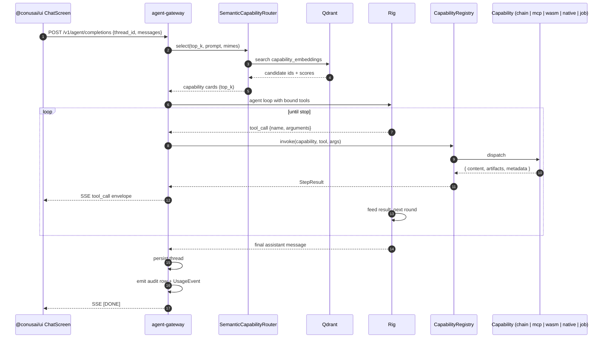
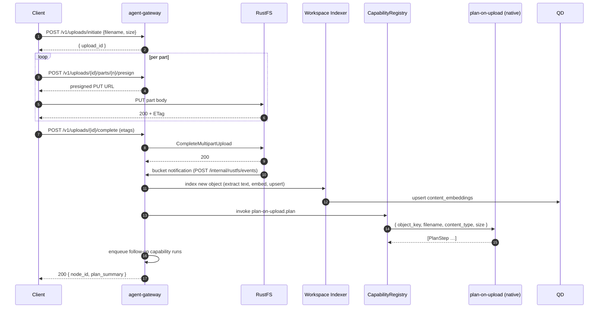

# ConusAI Platform — Architecture Reference

> **Audit date:** 2026-10-16 (deployment, auth, environment, observability, web and shell auth re-derived for the ConusAI Cloud refactor)
> **Workspace version:** 0.3.1 (Cargo workspace), pnpm workspace `@conusai/*` 0.6.0
> **Status:** Source of truth — fully re-derived from current code. Supersedes all
> prior revisions of this file.
>
> This document is the canonical architecture reference for the ConusAI platform.
> It is generated by reading the repository directly (no inference from older
> docs) and is intentionally exhaustive: every HTTP route, every environment
> variable, every database table, every Tauri command, every UI primitive,
> every capability manifest field, every infra service. When you change the
> code, update this file in the same commit.

---

## Table of Contents

1. [Overview](#1-overview)
2. [Repository Topology](#2-repository-topology)
3. [Version Matrix](#3-version-matrix)
4. [Architectural Principles](#4-architectural-principles)
5. [Backend — Agent Gateway](#5-backend--agent-gateway)
   - 5.1 [Process Bootstrap & Router Assembly](#51-process-bootstrap--router-assembly)
   - 5.2 [Full HTTP Route Table](#52-full-http-route-table)
   - 5.3 [Middleware Chain](#53-middleware-chain)
   - 5.4 [Authentication Adapters](#54-authentication-adapters)
   - 5.5 [`agent-core` Module Map](#55-agent-core-module-map)
   - 5.6 [`common` Module Map](#56-common-module-map)
   - 5.7 [`billing-core` Module Map](#57-billing-core-module-map)
   - 5.8 [`jobs` Crate (Background Worker)](#58-jobs-crate-background-worker)
   - 5.9 [Capability Provider Taxonomy](#59-capability-provider-taxonomy)
   - 5.10 [Rig 0.36 Usage Map](#510-rig-036-usage-map)
   - 5.11 [Persistence Schema (redb, Qdrant, Postgres)](#511-persistence-schema-redb-qdrant-postgres)
   - 5.12 [Environment Variables](#512-environment-variables)
   - 5.13 [OpenAPI Assembly](#513-openapi-assembly)
   - 5.14 [Observability (Metrics, Traces, Logs)](#514-observability-metrics-traces-logs)
6. [Web App — `apps/web`](#6-web-app--appsweb)
7. [Browser Shell — `apps/browser-shell` (Tauri 2)](#7-browser-shell--appsbrowser-shell-tauri-2)
8. [Shared Packages](#8-shared-packages)
   - 8.1 [`@conusai/ui`](#81-conusaiui)
   - 8.2 [`@conusai/sdk`](#82-conusaisdk)
   - 8.3 [`@conusai/types`](#83-conusaitypes)
9. [Capability TOML Manifest Schema](#9-capability-toml-manifest-schema)
10. [Infrastructure & Tooling](#10-infrastructure--tooling)
11. [Sequence Diagrams](#11-sequence-diagrams)
12. [Operational Concerns](#12-operational-concerns)
13. [Appendix — File Trees](#13-appendix--file-trees)

---

## 1. Overview

ConusAI is a multitenant, plan-tiered AI agent platform. A user (or an external
client) talks to an **agent gateway** (Rust / Axum / Rig) which routes the turn
to a **capability** — an opaque tool implementation that can be:

- a **native** provider (Rust, compiled in)
- an **LLM chain** (data-driven prompt + JSON Schema, declared in TOML)
- a **remote MCP** server (JSON-RPC 2.0 over HTTPS)
- a **WASM** module (wasmtime 49, fuel/memory/epoch limits)
- a **job-backed** capability (returns `task_id`, work runs on a tokio-cron worker)

A **semantic router** (Qdrant + per-capability embeddings + scoring) selects the
top-K candidates per turn; the **Rig 0.36 agent loop** drives tool-calls against
Anthropic (Claude). Memory, threads, audit logs, and workspace metadata live in
an embedded **redb** v2 keyspace; vector embeddings live in **Qdrant**; bulk
content (uploads, generated artefacts) lives in **RustFS** (S3-compatible,
Apache 2.0) keyed per tenant via STS-style scoped IAM users.

The frontend ships two surfaces from a single codebase:

- **`apps/web`** — SvelteKit web app, server-rendered, runs as a Node process
- **`apps/browser-shell`** — Tauri 2 desktop + iOS + Android shell wrapping the same Svelte 5 frontend

Both consume the same component library (`packages/ui`), the same typed HTTP
SDK (`packages/sdk`), and the same OpenAPI-generated types (`packages/types`).

Identity is delegated to **Zitadel**: every protected gateway route takes
`Authorization: Bearer` with a Zitadel access token (or a hashed machine API
key); the tenant is the user's Zitadel organization. The web app is a
backend-for-frontend that holds the tokens server-side; the native shell holds
them in Rust. Billing/metering is delegated to **Lago**, which also decides
each tenant's plan. Telemetry leaves over OTLP HTTP/protobuf to ConusAI Cloud's
`/otel/v1` ingest; Prometheus text stays available on `/metrics` (platform
token). The whole stack deploys to **ConusAI Cloud** as one compose project
with linked managed Postgres, Redis, Qdrant and S3 (§10.7).

---

## 2. Repository Topology

```
epifly/
├── Cargo.toml                      # Rust workspace root (resolver "3", edition 2024, rust-version 1.99)
├── Cargo.lock
├── package.json                    # pnpm workspace root (pnpm 10.13.1, node ≥22)
├── pnpm-workspace.yaml             # Lists apps/* and packages/*
├── pnpm-lock.yaml
├── turbo.json                      # Turborepo pipeline (build, lint, test, gate scripts)
├── biome.json                      # Lint + format (Biome) for all JS/TS/Svelte
├── eslint.config.js                # ESLint flat config — Svelte parser + Biome bridge
├── playwright.config.ts            # Top-level Playwright config (web, iOS, shell e2e)
├── rust-toolchain.toml             # Pins 1.99.1
├── renovate.json                   # Renovate bot config
├── justfile                        # `just <recipe>`: up/down/logs/config (local stack), web/shell/backend dev
├── Makefile                        # CI helpers (verify-routes-doc, …)
├── conusai.json                    # ConusAI Cloud project config: compose file, required env names, public services, sizes
├── docker-compose.yml              # The deployed stack: gateway, web, current-time, zitadel, lago-migrate/api/worker/clock
├── docker-compose.local.yml        # Local only: adds Postgres, Redis (Valkey), Qdrant, RustFS and host ports
├── .env.example                    # Every variable, project vs linked-service (docs/deploy-conusai-cloud.md)
├── README.md
│
├── apps/
│   ├── backend/                    # Cargo workspace member crates (see §5)
│   │   ├── Dockerfile              # agent-gateway image (cargo-chef, debian trixie-slim, uid 10001)
│   │   ├── rust-toolchain.toml     # Pinned, overrides root if cargo runs here
│   │   ├── crates/
│   │   │   ├── agent-gateway/      # Axum HTTP server, route handlers, AppState, auth, env contract
│   │   │   ├── agent-core/         # Agents, capabilities, LLM, memory, vector store, identity
│   │   │   ├── common/             # Shared utilities (errors, env contract, secrets, telemetry, types)
│   │   │   ├── billing-core/       # Lago provider, plan catalog, quota
│   │   │   ├── jobs/               # Cron + ad-hoc background worker
│   │   │   └── rustfs-admin/       # S3-compatible RustFS bootstrap & IAM client
│   │   ├── evals/                  # CLI eval harness (`cargo run -p evals`)
│   │   ├── xtask/                  # Workspace task runner (`cargo xtask …`)
│   │   └── capabilities/           # 23 TOML manifests (see §9)
│   │
│   ├── web/                        # SvelteKit backend-for-frontend (port 3000 prod, 5173 dev)
│   │   ├── Dockerfile              # node 24 trixie-slim, adapter-node, uid 10001
│   │   ├── package.json            # 0.1.0 — SvelteKit 2.21, Svelte 5.33, adapter-node 5, openid-client 6
│   │   ├── svelte.config.js
│   │   ├── vite.config.ts          # dev port 5173; no dev proxy (the server routes proxy, as in prod)
│   │   ├── playwright.config.ts    # web-only e2e
│   │   ├── src/
│   │   │   ├── app.html
│   │   │   ├── hooks.server.ts     # init: validate env; session resolve + login redirect; security headers
│   │   │   ├── lib/
│   │   │   │   ├── sdk.ts          # createConusSdk, same-origin, no token in the browser
│   │   │   │   └── server/
│   │   │   │       ├── config.ts   # Web env contract (ORIGIN, GATEWAY_URL, ZITADEL_*, AUTH_SESSION_KEY)
│   │   │   │       ├── auth/       # oidc.ts, session.ts, seal.ts (AES-256-GCM), transaction.ts
│   │   │   │       ├── proxy.ts    # Same-origin proxy to the gateway (bearer injection)
│   │   │   │       ├── proxy-route.ts
│   │   │   │       └── gateway.ts  # Server-side gateway fetch for load functions
│   │   │   └── routes/             # See §6
│   │   ├── static/
│   │   └── e2e/                    # Playwright fixtures, visual + a11y + motion-budget specs
│   │
│   └── browser-shell/              # Tauri 2 shell (desktop + iOS + Android)
│       ├── package.json            # 0.4.0
│       ├── svelte.config.js        # adapter-static
│       ├── vite.config.ts          # dev port 5174
│       ├── scripts/tauri.mjs       # Tauri CLI wrapper
│       ├── src-tauri/              # Rust crate (see §7); src/auth/ = OIDC + Stronghold vault
│       └── src/                    # Svelte frontend (Tauri webview)
│
├── packages/
│   ├── ui/                         # @conusai/ui 0.6.0 (see §8.1)
│   ├── sdk/                        # @conusai/sdk 0.6.0 — typed HTTP client (see §8.2)
│   └── types/                      # @conusai/types 0.6.0 — generated from the OpenAPI document (see §8.3)
│
├── services/
│   └── current-time/               # FastAPI MCP example — self-registers via /admin/capabilities/register
│       ├── main.py
│       ├── Dockerfile              # python 3.14 slim, uid 10001
│       └── requirements.txt
│
├── docker/
│   └── zitadel/                    # bootstrap.sh + defaults.yaml — not referenced by any compose file
│
├── e2e/                            # Cross-app e2e (separate from apps/*/e2e)
│   ├── fixtures/                   # incl. mock-oidc.mjs (local OIDC issuer for web e2e)
│   ├── helpers/                    # incl. auth.ts
│   ├── ios/                        # iOS WebDriver runs (capabilities under apps/browser-shell/src-tauri/capabilities/)
│   ├── shell-macos/                # Desktop shell WDIO runs
│   ├── wdio/                       # WebdriverIO config
│   └── web/                        # Cross-app web spec collection
│
├── scripts/                        # Repo-wide helpers incl. generate-env.sh (see §10)
└── docs/
    ├── arch.md                     # ← this file
    ├── deploy-conusai-cloud.md     # Deployment procedure and every project variable
    ├── plan.md
    ├── ui-plan.md
    ├── ui-design.md
    ├── ui-inventory.md
    ├── ui-landmarks.md
    ├── ui-tokens-changelog.md
    ├── ui-runes-inventory.md
    ├── refactoring-ui.md
    ├── browser-shell-plan.md
    ├── browser-shell-user-guide.md
    ├── auth-plan.md
    ├── payments-plan.md
    ├── rustfs-plan.md
    ├── rg-plan.md
    ├── upload-plan.md
    ├── improve-plan.md
    ├── project-instructions.md
    ├── capability-authoring-guide.md
    ├── capability-gaps-plan.md
    ├── capability-gaps-pan.md
    ├── adr/
    ├── branding/
    ├── capabilities/
    ├── ops/                        # billing.md, rustfs.md, signing.md
    ├── tasks/
    └── verify/
```

---

## 3. Version Matrix

### Rust workspace (`Cargo.toml`)

- `resolver = "3"`, `edition = "2024"`, `rust-version = "1.99"` (toolchain 1.99.1)
- Workspace package version: `0.3.1`
- Members: `common`, `rustfs-admin`, `agent-core`, `jobs`, `billing-core`, `agent-gateway`, `evals`, `xtask`; `apps/browser-shell/src-tauri` is excluded and builds on its own
- Release profile: `opt-level = 3`, `lto = "thin"`, `codegen-units = 1`, `strip = "symbols"`

| Crate | Version (workspace = root, otherwise inline) | Key features |
|------|--------|---------------|
| `rig-core` | `0.36` | LLM agent framework — tool calling, streaming |
| `axum` | `0.8` | features: `ws`, `multipart` |
| `tokio` | `1` | `full` |
| `tower` | `0.5` | core |
| `tower-http` | `0.6` | `cors`, `trace`, `compression-br`, `fs` |
| `redb` | `2` | embedded KV |
| `postcard` | `1` | redb value codec |
| `qdrant-client` | `1` | `serde` |
| `reqwest` | `0.13` | `json`, `stream`, `multipart`, `form`, `query` |
| `opentelemetry`, `opentelemetry_sdk` | `0.33.1` | `trace`, `metrics`, `logs` |
| `opentelemetry-otlp` | `0.33.1` | `http-proto` + blocking reqwest client only (no gRPC) |
| `opentelemetry-appender-tracing`, `opentelemetry-prometheus` | `0.33.1` | logs bridge, Prometheus registry |
| `tracing-opentelemetry` | `0.34.0` |  |
| `prometheus` | `0.14` | `process`; text exposition |
| `wasmtime` | `49.0.3` | sandboxed core modules (fuel + memory + epoch limits) |
| `jsonwebtoken` | `11.1.0` | `rust_crypto`; Zitadel RS256 access-token verification |
| `blake3` | `1` | API-key hashing (`API_KEYS`) |
| `schemars` | `0.8` | JSON Schema gen |
| `object_store` | `0.11` | `aws` (RustFS) |
| `aes-gcm` | `0.10` | per-tenant S3 credentials at rest in redb |
| `argon2` | `0.5` | RustFS admin body encryption key derivation |
| `fastembed` | `5` | feature-gated local embeddings |
| `moka` | `0.12` | `future` — JWKS/introspection, plan and webhook caches |
| `tokio-cron-scheduler` | `0.13` | jobs |
| `utoipa` | `5` | OpenAPI document (`/openapi.json`; no Swagger UI) |
| `notify` | `7` | `macos_fsevent` — manifest hot-reload |
| `proptest` | `1` | property tests |
| `wiremock` | `0.6` | HTTP test doubles |

### pnpm workspace (`package.json`)

- pnpm `10.13.1`, node ≥ 22
- Top-level: Turborepo + Biome lint/format + ESLint flat config
- Workspaces: `apps/web`, `apps/browser-shell`, `packages/ui`, `packages/sdk`, `packages/types`

| Package | Version | Key deps |
|---------|---------|----------|
| `web` (`apps/web`) | 0.1.0 | SvelteKit 2.21, adapter-node 5.2.12, `openid-client` 6.8, Svelte 5.33, Vite 6.3.5, Tailwind v4 (`@tailwindcss/vite` 4.3), `bits-ui` 2.18, `tailwind-variants` 3.2, `tailwind-merge` 3.6, `clsx` 2.1, `lucide-svelte` 0.477, `@lucide/svelte` 1.16, `lighthouse` 13.3, `@axe-core/playwright` 4.11, `@playwright/test` 1.49 |
| `browser-shell` (`apps/browser-shell`) | 0.4.0 | SvelteKit + adapter-static 3, Svelte 5.33, `@tauri-apps/api` 2, `@tauri-apps/plugin-dialog` 2, `vite-plugin-static-copy` 1 |
| `browser-shell-tauri` (`src-tauri/Cargo.toml`) | 0.4.0 | tauri 2.12 + `unstable`, `tauri-plugin-{dialog,haptics}` 2, `tauri-plugin-stronghold` 2.4 (`kdf`), reqwest 0.13.5, optional `tauri-plugin-updater` (`updater` feature), optional `tauri-plugin-webdriver-automation` 0.1.3 (`e2e` feature) |
| `@conusai/ui` | 0.6.0 | Svelte 5 peer; deps: `@tauri-apps/plugin-haptics` 2.3.2, `lucide-svelte` 0.477 (dev); test dep `jsdom` 29.1 |
| `@conusai/sdk` | 0.6.0 | OpenAPI-derived types — runtime-free aside from fetch |
| `@conusai/types` | 0.6.0 | `openapi-typescript` 7; prebuild runs `scripts/openapi-to-types.sh` |

### Tauri config (`apps/browser-shell/src-tauri/tauri.conf.json`)

- `productName`: `ConusAI Browser`
- `identifier`: `com.conusai.browser`
- `devUrl`: `http://localhost:5174`
- `beforeDevCommand`: `pnpm --filter browser-shell dev`
- `frontendDist`: `../build` (relative to `src-tauri/`)
- Window: 1280×800 default, min 800×600
- Bundle targets: `app`, `dmg`, `msi`, `appimage`, `deb`
- macOS minimum: 12.0 (entitlements at `macos/entitlements.plist`)
- iOS minimum: 16.0
- Android minSdkVersion: 26
- Deep-link plugin: desktop scheme `conusai`, mobile host `open` with `pathPrefix ["/"]`
- CSP in the file: `default-src 'self'; connect-src 'self' ipc: http://ipc.localhost; img-src 'self' data: blob:; …` — no remote origin. `scripts/tauri.mjs` (the `tauri` script) requires `VITE_GATEWAY_URL`, `VITE_ZITADEL_ISSUER` and `VITE_ZITADEL_NATIVE_CLIENT_ID` for `dev`/`build` and adds the gateway origin to `connect-src`/`img-src`; the issuer is not added (only Rust talks to Zitadel)

---

## 4. Architectural Principles

Eleven hard rules. Every PR is reviewed against this list.

1. **Everything is a capability.** Native code, LLM prompts, remote MCP servers,
   WASM components, and background jobs all implement the same `CapabilityProvider`
   trait. The agent loop never knows which kind it called. (ADR-0007.)
2. **Cross-platform code goes in `packages/ui`.** Anything that runs on web AND
   on the Tauri shell must live in `@conusai/ui`. Apps wire it together; apps
   do not duplicate components, stores, or motion primitives. `scripts/check-cross-app-imports.mjs`
   gates this in CI.
3. **No `apps/web`-only or `apps/browser-shell`-only stores.** All Svelte 5
   runes-based stores live in `packages/ui/src/lib/stores/`. Apps may inject
   adapters (e.g., `localStorageAdapter`) but never reimplement state.
4. **No hardcoded design tokens.** Every colour, radius, spacing, type-scale
   value is a CSS variable defined in `tokens.css` + `foundry.css`.
   `scripts/check-design-tokens.mjs` rejects raw hex/rgb literals outside the
   token files.
5. **Plan tiers gate routes, not features.** Plan checks live in
   `mw::plan::enforce_plan` and `mw::router_quota`, and the plan itself is
   resolved server-side from Lago (`plans.rs`), never from a client. UI may show degraded
   states, but enforcement is server-side.
6. **Tenancy is enforced at the redb / Qdrant / S3 boundary, not in handlers.**
   Stores accept `tenant_id` as part of every key. `TenantStorageFactory`
   issues per-tenant scoped IAM credentials so a leaked handler bug cannot
   cross tenant boundaries.
7. **OpenAPI is generated, not hand-written.** `utoipa` derives schema from
   handler signatures + types; `packages/types` regenerates on `pnpm prebuild`.
   `Makefile` target `verify-routes-doc` diffs `--dump-routes` output against
   `docs/arch.md` §5.2.
8. **Capabilities self-register.** A TOML manifest under
   `apps/backend/capabilities/<name>/capability.toml` is enough to expose a
   tool. Optional Rust wiring is needed only for `kind = "native"` or
   `kind = "wasm"`. Hot-reload is driven by `notify` 7 (`ManifestWatcher`).
9. **OpenAI compatibility is a fixed contract.** `POST /v1/chat/completions`
   stays bytewise compatible with the OpenAI SSE chat protocol so existing
   SDKs work unchanged. Agent-aware features live under `/v1/agent/*`.
10. **All state changes emit an audit row.** `AuditStore` is wired into every
    mutating handler. Retention is `AUDIT_RETENTION_DAYS` (default 90), enforced
    by `AuditLogCleanupJob`.
11. **Reduced motion is a first-class output.** Any animation crossing the
    `prefers-reduced-motion: reduce` boundary must drop to a fade or be removed.
    `e2e/reduced-motion.spec.ts` (apps/web) enforces ≤80 ms total animation
    duration in the primitive gallery.

---

## 5. Backend — Agent Gateway

### 5.1 Process Bootstrap & Router Assembly

`apps/backend/crates/agent-gateway/src/main.rs` is the entry point. Boot order:

1. CLI flags that exit before anything else:
   `--dump-routes` prints `routes::dump_routes_markdown()` (what
   `make verify-routes-doc` calls); `--hash-api-key` reads a key from stdin and
   prints its BLAKE3 hex for `API_KEYS`; `--dump-openapi` prints the OpenAPI
   document.
2. Validate the whole environment contract: `GatewayConfig::from_env()`
   (`config.rs`, built on `common::env::EnvContract`). On failure it prints
   `agent-gateway: environment contract not satisfied; missing: …; invalid: …`
   naming every offending variable and exits with code **2** (§5.12).
3. Initialise telemetry: `common::telemetry::init("agent-gateway", "info")`
   returns a guard and a `prometheus::Registry` (§5.14).
4. Register metric vecs: `billing_core::metrics::register`,
   `RustFsMetrics::register`, `RouterMetrics::register`.
5. Build `AppState::from_config(&cfg)` (`state.rs`).
6. Spawn the 30-second loop that mirrors the onboarding counters (onboarding
   totals, marker failures) into Prometheus.
7. Run declarative RustFS bootstrap (`rustfs_admin::bootstrap_storage`) unless
   `RUSTFS_BOOTSTRAP=off`.
8. Verify LLM provider registry (`agent_core::llm::verify_llm_providers`).
9. Seed Lago plan catalog (`BillingProvider::ensure_plans`) if `LAGO_API_KEY` is set.
10. Start cron scheduler (`JobSchedulerService::start`).
11. Build the router (`build_router`): `public_router`, then
    `protected_router` + `ui::ui_router` (with `meter::record_usage` and
    `plan::enforce_plan`) and `admin_router`, each wrapped in
    `auth::authenticate`, `trace::propagate_trace` and
    `request_id::inject_request_id`; `internal_router` only when
    `RUSTFS_NOTIFICATION_WEBHOOK_URL`/`RUSTFS_WEBHOOK_SECRET` are set; `/metrics`;
    then CORS and `tower-http`'s `TraceLayer` outermost.
12. Bind to `0.0.0.0:$PORT` (default 8080) and serve with graceful shutdown on
    SIGINT/SIGTERM.

`build_cors()`:

- Origins: `WEB_ORIGIN` (required, comma-separated http(s) origins) plus the
  native shell's `tauri://localhost` and `http://tauri.localhost`
- Methods: `GET POST PATCH DELETE OPTIONS`
- Allowed headers: `Authorization, Content-Type, traceparent`
- Exposed headers: `X-Request-Id`
- No credentials: authentication travels in the `Authorization` header only,
  never in cookies

### 5.2 Full HTTP Route Table

Every route is statically declared in `routes::mod::ROUTE_TABLE` so the
`--dump-routes` CLI flag prints a Markdown table that CI compares against this
document. **If you add a route, add it to both `ROUTE_TABLE` and the matching
`Router::new().route(...)` call.**

#### 5.2.1 Public (`public_router`) — no auth

| Method | Path | Auth | Handler | Notes |
|--------|------|------|---------|-------|
| `GET`  | `/health`                          | none      | `health::health`                       | Liveness probe |
| `GET`  | `/healthz/embeddings`              | none      | `health::embeddings_ready`             | Returns 200 when embedding model is loaded |
| `POST` | `/v1/billing/webhooks`             | hmac-sig  | `billing_webhook::handle_webhook`      | Lago webhooks, sig verified inside handler |
| `POST` | `/admin/capabilities/register`     | platform-token | `admin_capabilities::register_capability` | Self-registration for sidecar MCP services |
| `GET`  | `/openapi.json`                    | none      | `openapi_json`                         | Generated OpenAPI document (also `agent-gateway --dump-openapi`) |
| `GET`  | `/metrics`                         | platform-token | `metrics_handler` (`main.rs`)     | Prometheus text; `Authorization: Bearer <PLATFORM_ADMIN_TOKEN>`, else 401 |

#### 5.2.2 Internal (`internal_router`) — mounted only when RustFS notifications are configured

| Method | Path | Auth | Handler | Notes |
|--------|------|------|---------|-------|
| `POST` | `/internal/rustfs/events`          | hmac-sig  | `internal::rustfs_events`              | RustFS bucket notification webhook → triggers re-indexing |

Sig verification uses `RUSTFS_WEBHOOK_SECRET` (HMAC-SHA256 over body, header `X-RustFS-Signature` or `X-Minio-Signature`, hex).

#### 5.2.3 Protected (`protected_router` + `ui_router`) — `Authorization: Bearer` (Zitadel access token or API key) + plan enforcement

| Method | Path | Auth | Handler | Notes |
|--------|------|------|---------|-------|
| `POST` | `/v1/chat/completions`             | bearer | `chat::completions`     | OpenAI-compat; quota-gated |
| `POST` | `/v1/agent/completions`            | bearer | `agent::agent_completions` | Thread-aware agent loop; quota-gated |
| `GET`  | `/v1/capabilities`                 | bearer | `capabilities::list_capabilities` | Tool registry snapshot |
| `GET`  | `/v1/capabilities/search`          | bearer | `search::search`         | Semantic search via Qdrant |
| `POST` | `/mcp`                             | bearer | `mcp::dispatch`          | MCP JSON-RPC 2.0 dispatch |
| `POST` | `/v1/files/upload-url`             | bearer | `files::presign_upload`  | Pre-signed PUT (single part) |
| `GET`  | `/v1/files/download-url`           | bearer | `files::presign_download` | Pre-signed GET |
| `POST` | `/v1/uploads/initiate`             | bearer | `uploads::initiate`      | Begin multipart |
| `POST` | `/v1/uploads/{upload_id}/parts/{n}/presign` | bearer | `uploads::presign_part` | Part-N PUT URL |
| `POST` | `/v1/uploads/{upload_id}/complete` | bearer | `uploads::complete`      | Final MPU complete |
| `POST` | `/v1/uploads/{upload_id}/abort`    | bearer | `uploads::abort`         | Cancel + reap |
| `GET`  | `/v1/audit`                        | bearer | `audit::list_audit`      | Tenant-scoped audit log |
| `POST` | `/v1/workspaces`                   | bearer | `workspaces::create`     | Create workspace root or folder |
| `GET`  | `/v1/workspaces/tree`              | bearer | `workspaces::tree`       | Returns hierarchical tree |
| `GET`  | `/v1/workspaces/search`            | bearer | `workspaces::search`     | Hybrid (path + vector) |
| `GET`  | `/v1/workspaces/{id}`              | bearer | `workspaces::get_node`   | Node metadata |
| `DELETE` | `/v1/workspaces/{id}`            | bearer | `workspaces::delete_node` | Recursive delete |
| `GET`  | `/v1/workspaces/{id}/content`      | bearer | `workspaces::get_content` | For text-content nodes |
| `PATCH` | `/v1/workspaces/{id}/content`     | bearer | `workspaces::patch_content` | RFC-6902 ops |
| `POST` | `/v1/workspaces/{id}/move`         | bearer | `workspaces::move_node`  | Move within hierarchy |
| `POST` | `/v1/workspaces/{id}/rename`       | bearer | `workspaces::rename_node` |  |
| `POST` | `/v1/workspaces/{id}/share`        | bearer | `workspaces::share_node` | Create share token |
| `POST` | `/v1/workspaces/{id}/unshare`      | bearer | `workspaces::unshare_node` | Revoke share token |
| `POST` | `/v1/workspaces/{id}/presign-upload` | bearer | `workspaces::presign_upload` | Direct workspace upload |
| `GET`  | `/v1/workspaces/{id}/presign-download` | bearer | `workspaces::presign_download` | Direct workspace download |
| `GET`  | `/v1/workspaces/nodes/{id}/versions` | bearer | `workspaces::list_versions` | RustFS object-version history |
| `POST` | `/v1/workspaces/nodes/{id}/restore` | bearer | `workspaces::restore_version` | Restore prior version |
| `GET`  | `/v1/tasks`                        | bearer | `tasks::list_tasks`      | Background job task list |
| `GET`  | `/v1/tasks/{id}`                   | bearer | `tasks::get_task`        | Task status snapshot |
| `GET`  | `/v1/tasks/{id}/sse`               | bearer | `tasks::task_sse`        | SSE progress stream |
| `GET`  | `/v1/threads`                      | bearer | `threads::list`          | Thread summaries |
| `GET`  | `/v1/threads/{id}/messages`        | bearer | `threads::get_messages`  | Paginated messages |
| `GET`  | `/api/realtime/workspace`          | bearer | `realtime::realtime_workspace` | WebSocket of workspace change events (not reachable through the web app's proxy, which does not forward upgrades) |
| `GET`  | `/v1/billing/plans`                | bearer | `billing::list_plans`    | Public plan catalog |
| `GET`  | `/v1/billing/subscription`         | bearer | `billing::get_subscription` | Current subscription |
| `POST` | `/v1/billing/subscriptions`        | bearer | `billing::create_subscription` | Upgrade flow |
| `DELETE` | `/v1/billing/subscription`       | bearer | `billing::cancel_subscription` | Cancel |
| `POST` | `/v1/billing/portal`               | bearer | `billing::billing_portal` | Stripe portal URL |
| `GET`  | `/v1/billing/invoices`             | bearer | `billing::list_invoices` | Per-tenant invoices |
| `GET`  | `/v1/billing/usage`                | bearer | `billing::get_usage`     | Period-to-date usage |
| `POST` | `/ui/stream`                       | bearer | `ui::handlers::chat::ui_stream` | Chat stream for the UI |
| `POST` | `/ui/upload`                       | bearer | `ui::handlers::upload::ui_upload` | Multipart upload for the UI |
| `GET`  | `/ui/files/download`               | bearer | `ui::handlers::files::ui_download` | Download for the UI |

#### 5.2.4 Admin (`admin_router`) — bearer with the `super_admin` role

Gated by `auth::authenticate` then `auth::require_super_admin`: the caller's
role must be `SuperAdmin`, which comes only from the Zitadel project role
`super_admin` (`urn:zitadel:iam:org:project:roles`). API keys always map to
`User`. Anything else is 403.

| Method | Path | Handler |
|--------|------|---------|
| `GET`    | `/admin/capabilities`                    | `admin_capabilities::list` |
| `POST`   | `/admin/capabilities`                    | `admin_capabilities::create` |
| `POST`   | `/admin/capabilities/reload`             | `admin_capabilities::reload_all` |
| `POST`   | `/admin/capabilities/validate`           | `admin_capabilities::validate` |
| `POST`   | `/admin/capabilities/test`               | `admin_capabilities::test_invoke` |
| `GET`    | `/admin/capabilities/{name}`             | `admin_capabilities::get_one` |
| `GET`    | `/admin/capabilities/{name}/manifest`    | `admin_capabilities::get_manifest` |
| `PATCH`  | `/admin/capabilities/{name}`             | `admin_capabilities::update` |
| `PATCH`  | `/admin/capabilities/{name}/enabled`     | `admin_capabilities::set_enabled` |
| `DELETE` | `/admin/capabilities/{name}`             | `admin_capabilities::delete_one` |
| `POST`   | `/admin/capabilities/{name}/reload`      | `admin_capabilities::reload_one` |
| `GET`    | `/admin/capabilities/namespaces`         | `admin_capabilities::list_namespaces` |
| `GET`    | `/admin/jobs`                            | `admin_jobs::list_jobs` |
| `GET`    | `/admin/jobs/{name}`                     | `admin_jobs::get_job` |
| `POST`   | `/admin/jobs/{name}/run`                 | `admin_jobs::run_now` |
| `GET`    | `/admin/tasks`                           | `admin_jobs::list_tasks` |
| `POST`   | `/admin/billing/credits`                 | `billing::admin_add_credits` |
| `POST`   | `/admin/billing/cancel/{tenant_id}`      | `billing::admin_cancel_subscription` |
| `GET`    | `/admin/billing/dashboard`               | `billing::admin_billing_dashboard` |
| `DELETE` | `/admin/tenants/{id}`                    | `admin_tenants::delete_tenant` |

#### 5.2.5 Request / Response payload shapes

Detailed schemas are emitted to `/openapi.json` and consumed by
`@conusai/types` via `scripts/openapi-to-types.sh`. The hot paths:

- `POST /v1/chat/completions` — request body **identical** to OpenAI Chat
  Completions API v1 (`model`, `messages`, `stream`, `temperature`, `max_tokens`,
  `tools`, `tool_choice`, …). Response: either streamed SSE `data: { ... }`
  events (matching OpenAI delta wire format) or a single JSON envelope. Special
  field `routing` (non-OpenAI) under `usage` declares which capabilities the
  semantic router picked.
- `POST /v1/agent/completions` — extends the chat payload with `thread_id`
  (optional), `tenant_overrides` (no-op outside admin), `attachments[]` (uploaded
  file refs). Response includes structured `tool_calls[]` with `capability`,
  `tool`, `request`, `response`, `started_at_ms`, `latency_ms`.
- `POST /mcp` — JSON-RPC 2.0: `{ jsonrpc: "2.0", id, method, params }`.
  `method` is one of `tools/list`, `tools/call`. `params` for `tools/call`:
  `{ name, arguments }`.
- Upload-flow envelopes — see §11 sequence diagrams.

### 5.3 Middleware Chain

Authentication is one function, `agent-gateway/src/auth.rs::authenticate`;
the rest lives in `apps/backend/crates/agent-gateway/src/mw/`. Order for a
protected request, outermost first:

| Where | Layer | Applies to | Behaviour |
|------|-------|-------|-----------|
| `main.rs` | `TraceLayer` (`tower-http`) | everything | Span per request with method/path/status/duration |
| `main.rs` | `build_cors()` | everything | §5.1 |
| `mw/request_id.rs` | `inject_request_id` | protected, ui, admin | Reads or generates `X-Request-ID`, echoes it, adds `request_id` to JSON error bodies |
| `mw/trace.rs` | `propagate_trace` | protected, ui, admin | W3C `traceparent`/`tracestate` → parent of the request span |
| `auth.rs` | `authenticate` | protected, ui, admin | Requires `Authorization: Bearer <token>`. The token is matched first against `API_KEYS` (BLAKE3, constant-time over all entries) and otherwise verified as a Zitadel access token (§5.4). Builds `TenantContext { tenant_id, user_id, plan, role }` and inserts `ResolvedTenant`. Missing/invalid → 401 with `WWW-Authenticate: Bearer`; IdP unreachable → 503. No cookies, session headers, tenant headers or credential-less mode |
| `auth.rs` | `require_super_admin` | admin | 403 unless `role == SuperAdmin` |
| `mw/plan.rs` | `enforce_plan` | protected, ui | Inserts `PlanLimits` for the resolved plan |
| `mw/meter.rs` | `record_usage` | protected, ui (after the handler) | Reads `AgentTurnStats` from the response and reports usage to Lago (`BillingProvider`) and the quota counter |
| `mw/router_quota.rs` | `RouterQuotaLayer` (route layer) | `/v1/chat/completions`, `/v1/agent/completions` | Per-turn tool budget and daily plan quota (`QuotaChecker`); 429 with an upgrade URL (`BILLING_RETURN_URL`) when exceeded |
| `mw/rate_limit.rs` | `RateLimiter` (called from handlers) | chat, files, uploads, mcp, capabilities | Fixed-window counter per tenant |

The plan is never read from a client: `plans.rs::PlanResolver` maps the
tenant's Lago subscription (status active or trialing) by plan code — `pro` →
Pro, `team`/`enterprise` → Enterprise, anything else → Free — caches it for
5 minutes (failed lookups: Free for 30 s), and is invalidated by Lago
subscription webhooks. Without `LAGO_API_KEY` every tenant is Free.

The model of a client-facing turn comes from `LlmRegistry::select_for_plan`:
the client may request an alias (or the model id it resolves to) from the
plan's allowlist (`PlanTier::allowed_aliases`: Free `haiku`, `fast`, `cheap`;
Pro adds `smart`; Enterprise adds `opus`); no request → the plan's default
alias; anything else → 403 `ModelNotAllowed`.

### 5.4 Authentication Adapters

The gateway accepts exactly two credentials, both as `Authorization: Bearer`:

- **Zitadel access token** — `agent-core/src/identity/zitadel.rs::ZitadelVerifier`
  (trait `TokenVerifier`):
  - **JWT**: signature against the issuer's JWKS (found through
    `${ZITADEL_ISSUER}/.well-known/openid-configuration`, whose `issuer` must
    equal `ZITADEL_ISSUER`); **RS256 only**; `iss` = `ZITADEL_ISSUER`; `aud`
    contains `ZITADEL_AUDIENCE`; `exp`/`nbf` with 60 s leeway. JWKS cached
    10 min; an unknown `kid` triggers at most one refetch per 30 s.
  - **Opaque**: checked at the introspection endpoint with Basic auth when
    `ZITADEL_INTROSPECTION_CLIENT_ID`/`_SECRET` are set (results cached 60 s);
    refused otherwise. A JWT-shaped token never falls back to introspection.
  - Tenant = `urn:zitadel:iam:user:resourceowner:id` (the user's Zitadel
    organization; present when the client requested the scope
    `urn:zitadel:iam:user:resourceowner`); a token without it is rejected.
    Role = highest of the keys in `urn:zitadel:iam:org:project:roles`:
    `super_admin` → `SuperAdmin`, `admin` → `Admin`, else `User`. Email is
    display-only. Nothing about plans is read from tokens.
  - Issuer must be https (http only for a loopback host).
- **API key** (machine clients) — `API_KEYS=<blake3-hex>:<tenant>:<label>,…`
  parsed by `auth.rs::parse_api_keys`; only the hash is configured. Generate
  the hash with `agent-gateway --hash-api-key` (key on stdin). User id is
  `api-key:<label>`, role `User`.

`PLATFORM_ADMIN_TOKEN` is a third, narrow credential: it authorises only
`GET /metrics` and `POST /admin/capabilities/register` (constant-time compare).

Browser and native clients:

- **Web** (`apps/web`) — backend-for-frontend; the browser never sees a token.
  See §6.2–6.3: tokens live in the AES-256-GCM sealed cookie
  `__Host-epifly_session` and the server-side proxy adds the bearer.
- **Shell** (`apps/browser-shell`) — Rust performs the OIDC flow and keeps the
  refresh token in Stronghold; the webview asks Rust for a short-lived access
  token per request (§7.2).

### 5.5 `agent-core` Module Map

`apps/backend/crates/agent-core/src/`:

```
agent/
  builder.rs       — Agent + AgentBuilder. Wraps rig::agent::AgentBuilder; wires
                     tools (CapabilityProvider → rig::tool::Tool), system prompt,
                     OrchestrationHook + PermissionHook + TracingHook.
  hooks.rs         — OrchestrationHook (mutate plan), PermissionHook (deny
                     capability invocations), TracingHook (emit OTel spans).
  runtime.rs       — map_rig_error → ConusAiError. The streaming run loop:
                     turn-state, SSE assembly, tool-call dispatch.
  mod.rs

bridge/            — ArtifactBridge (turns RustFS object keys into stable URLs
                     for the UI). Honours RUSTFS_PUBLIC_BASE_URL.

capabilities/
  admin.rs         — CapabilityAdmin (CRUD on the registry from /admin handlers).
                     AdminLimits (compiled in): 64 capabilities, 65 536-byte
                     manifests, 8 MiB wasm.
  card.rs          — CapabilityCard: name, namespace, description, search keywords,
                     embedding vector, accepts/emits, cost hint.
  discovery.rs     — CapabilityDiscovery (load from CONUSAI_CAPABILITIES_DIR)
                     + ManifestWatcher (notify 7 — fsevent on macOS).
  embedding.rs     — Computes per-capability embeddings (name + description +
                     search_keywords + tool names).
  executor.rs      — Plan execution: PlanStep, StepResult, run_plan. Strategies:
                     single | parallel_consensus | fallback_cascade.
                     GATEWAY_INTERNAL_URL is used when a capability needs to
                     call back into the gateway.
  manifest.rs      — TOML schema: SCHEMA_VERSION ("2.0"), AcceptSpec (bare or
                     full), CostHint (bare bucket label or full struct),
                     LlmChainConfig.
  mcp_adapter.rs   — Wraps a remote MCP endpoint as a CapabilityProvider.
  mcp_allowlist.rs — Exact host / host:port allowlist for every outbound MCP
                     endpoint (CONUSAI_MCP_ALLOWED_HOSTS; empty = deny all).
  namespace.rs     — NamespaceFilter (semantic router prefix matching).
  object_source.rs — Tenant-scoped object reads for file inputs (object keys in
                     the caller's storage, never local paths or URLs).
  provider.rs      — CapabilityProvider trait + BulkCapabilityFactory.
  providers/
    chain.rs           — PromptChainCapability (kind = "chain").
    dynamic_prompt.rs  — DynamicPromptCapability — chain with prompt drawn from
                         tenant config.
    job_backed.rs      — JobBackedProvider, JobDispatch. transcribe_video_provider
                         lives here (kind = "native" wired in state.rs).
    mcp.rs             — Local-MCP capability (process-spawn variant).
    native_storage.rs  — storage-workspace, wrapping the workspace store directly.
    remote_mcp.rs      — HTTPS MCP capability (sense-mime, current-time, …).
    wasm.rs            — WasmRuntime: one wasmtime 49 engine, fuel + memory +
                         epoch limits, module cache by path and mtime.
  registry.rs      — CapabilityRegistry (Mutex<HashMap<…>>). Hot-reload swaps
                     entries atomically.
  semantic_router.rs — SemanticCapabilityRouter (Qdrant query + threshold
                       scoring). SemanticRouterConfig: SEMANTIC_ROUTER_TOP_K (4),
                       min_confidence (CONUSAI_ROUTER_MIN_CONFIDENCE).
                       AttachmentHint (mimes → boost candidates).
                       RouterMetrics: per-decision histograms.
  store.rs         — FilesystemStore for hot-reloadable manifest TOMLs.
  validator.rs     — RegisteredToolValidator.

chains/
  llm_chain.rs     — PromptChainCapability (kind="chain") implementation.
  dynamic_prompt.rs — Tenant-scoped variant.
  executor.rs      — Drives the chain through the LLM registry; renders
                     {{tenant.id}} / {{input.field}} placeholders.

context/
  conversation.rs  — ConversationService trait + DefaultConversationService:
                     load thread, apply truncator, persist new messages.
  tenant.rs        — TenantContext, TenantClaims, PlanLimits, PlanTier (free,
                     pro, team, enterprise), SubscriptionStatus, UserRole.

identity/          — see §5.4
indexing/
  embedding_service.rs       — EmbeddingService trait. EmbeddingModel enum maps
                                EMBEDDING_LOCAL_MODEL env to (name, dims).
  local_embedding_service.rs — fastembed 5. Honours EMBEDDING_MAX_BATCH,
                                EMBEDDING_CACHE_DIR. Feature-gated by
                                `local-embeddings` Cargo feature.

llm/
  mod.rs           — LlmRegistry, LlmBinding (alias → concrete model).
                     LlmRequest/LlmResponse/LlmChunk/LlmStream/LlmUsage.
  error.rs         — LlmError.
  provider.rs      — CompletionProvider trait.
  registry.rs      — LlmRegistry: resolve_binding, select_for_plan (plan model
                     allowlist). Aliases are built in agent-gateway state.rs
                     (smart, opus, haiku, fast, cheap; LLM_ALIAS_<ALIAS> overrides).
  streaming.rs     — SSE chunk assembler.
  types.rs
  providers/
    anthropic.rs   — AnthropicProvider (rig-core anthropic + reqwest streaming).
                     Reads ANTHROPIC_API_KEY.
    mod.rs

memory/
  context_builder.rs — ContextBuilder: assembles system + history + tool messages
                       under a token budget. OldestFirstTruncator is the only
                       built-in truncator.
  truncator.rs       — ContextTruncator trait.

prompt/             — Shared prompt fragments (also used by common::prompt).

realtime/
  mod.rs            — RealtimeService (workspace SSE), InvalidationBus
                      (tokio broadcast), WorkspaceChangeEvent.

store/
  redb_metadata.rs  — RedbMetadataStore. Implements ThreadStore + AuditStore +
                      WorkspaceStore via redb 2. Table defs in §5.11.
  creds.rs          — CredentialStore. AES-GCM encrypted IAM creds in redb
                      table `iam_tenant_creds`. Key from RUSTFS_IAM_ENC_KEY
                      (base64 of 32 bytes). 96-bit nonce per record.
  tenant_storage.rs — TenantStorageFactory: STS-style scoped IAM users for
                      each tenant; a tenant without credentials gets
                      MissingTenantCreds, never the root keys.
  rustfs_content.rs — RustFsContentStore (WorkspaceContentStore impl over RustFS).
  qdrant_vector.rs  — QdrantVectorStore (gRPC, QDRANT_GRPC_URL + QDRANT_API_KEY).
                      Two collections: capability_embeddings_d{dims} and
                      content_embeddings_d{dims}. ensure_collections on connect.
  marker.rs         — HttpMarkerClient (PDF→Markdown sidecar). MARKER_URL.
  onboarding.rs     — TenantOnboardingService — bucket creation, IAM provisioning,
                      default workspace root marker.
  quota.rs          — StorageQuotaService. RUSTFS_QUOTAS (on by default).

vector_store/      — Vector store trait (Qdrant impl is in store/).
lib.rs             — Public re-exports (see source).
```

### 5.6 `common` Module Map

`apps/backend/crates/common/src/`:

```
artifact.rs   — Artifact value object (URL, mime, sha256, name).
audit.rs      — AuditStore trait + AuditEvent type.
env.rs        — EnvContract: required/optional/parse_or/switch; finish()
                 returns one error naming every missing or invalid variable.
error.rs      — ConusAiError (Storage, Config, Validation, Auth, NotFound,
                 LlmProvider, …). ErrorEnvelope is the wire shape used by
                 every handler.
eval.rs       — Eval harness types (Scorecard, EvalRun).
http_client.rs — Shared reqwest client builder.
limits.rs     — Per-route payload size caps.
mcp.rs        — MCP wire types (JsonRpcRequest / JsonRpcResponse).
memory/
  inmem.rs    — InMemory{Audit,Thread,Workspace,WorkspaceContent}Store (tests).
metrics.rs    — Prometheus helpers.
path_safety.rs — Reject "../", control bytes, NULs in workspace paths.
path_template.rs — Render {{input.x}} / {{tenant.id}} into URL or path strings.
prompt/        — Shared prompt builders.
secret.rs      — bearer_token (Authorization header parsing), constant_time_eq.
telemetry.rs   — common::telemetry::init: JSON logs on stdout, Prometheus
                 registry, and OTLP HTTP/protobuf export of traces, metrics and
                 logs when OTEL_EXPORTER_OTLP_ENDPOINT is set (§5.14).
trace.rs       — Span helpers.
types.rs       — Plumbing types shared between gateway and agent-core.
```

### 5.7 `billing-core` Module Map

`apps/backend/crates/billing-core/src/`:

```
catalog.rs   — PlanCatalog. Loads from CONUSAI_PLAN_CATALOG_PATH (TOML) or
               falls back to the built-in catalog (free/pro/team/enterprise).
error.rs     — BillingError.
events.rs    — UsageEvent + ActionType (chat_request, agent_request,
               capability_call, storage_byte_day, …).
lago.rs      — LagoProvider. LAGO_API_URL (https://api.getlago.com),
               LAGO_API_KEY (required), LAGO_WEBHOOK_SECRET.
metrics.rs   — Prometheus: conusai_quota_denied_total,
               conusai_billing_webhook_total,
               conusai_oidc_verify_duration_seconds.
provider.rs  — BillingProvider trait (record_usage, ensure_plans, get_subscription,
               create_subscription, cancel_subscription, get_invoices,
               get_usage, billing_portal).
quota.rs     — QuotaChecker + QuotaDecision (allow / soft_limit / hard_limit
               with upgrade_url).
types.rs     — PlanDefinition (id, tier, monthly_price, included_units,
               overage_price), Subscription, SubscriptionStatus, Invoice.
lib.rs       — Re-exports.
```

### 5.8 `jobs` Crate (Background Worker)

`apps/backend/crates/jobs/src/`:

```
admin.rs     — JobAdmin (CRUD-like façade used by /admin/jobs/*).
context.rs   — JobContext (tenant id, job inputs, JobOutputBuilder).
executor.rs  — JobExecutor. Runs a single job invocation, handles task progress.
job.rs       — Job trait + JobMetadata (name, kind, cron expression, enabled).
registry.rs  — JobRegistry — list, get, run-now.
scheduler.rs — JobSchedulerService (tokio-cron-scheduler 0.13). Loads cron
               expressions from each Job::metadata().cron and dispatches to
               the executor.
jobs/
  mod.rs
  audit_log_cleanup.rs    — AuditLogCleanupJob. AUDIT_RETENTION_DAYS (90).
                             Daily 03:00 UTC.
  capability_health_check.rs — CapabilityHealthCheckJob. Pings remote MCP
                                capabilities; marks degraded ones.
  lago_reconcile.rs       — LagoReconcileJob. Re-syncs missed usage events.
  rustfs_key_rotation.rs  — RustFsKeyRotationJob. RUSTFS_KEY_ROTATION_DAYS.
  tenant_bucket_migration.rs — TenantBucketMigrationJob. MIGRATION_DRY_RUN,
                                 MIGRATION_TENANT_ID.
  video_transcription.rs  — VideoTranscriptionJob. Reads OPENAI_API_KEY for
                             Whisper API; result stored in RustFS, task SSE
                             emits chunks.
lib.rs       — Re-exports.
```

### 5.9 Capability Provider Taxonomy

Five concrete kinds, all implementing the same trait:

| Kind | Source of truth | Wired in | Runtime |
|------|-----------------|----------|---------|
| `native` | Rust impl in `agent-core::capabilities::providers::*` | `state.rs` registers Rust factory; TOML manifest only declares the contract | Compiled in |
| `chain` | TOML `[chain]` block (model, system_prompt, prompt_template, vision, max_tokens, output_schema) | Auto-registered from TOML | LLM call via `LlmRegistry` |
| `wasm` | `.wasm` module referenced by TOML `[wasm]` | Auto-registered from TOML | wasmtime 49 (fuel, memory and epoch limits) |
| `mcp` (remote) | TOML `[mcp]` block (endpoint URL + auth) | Auto-registered from TOML | reqwest 0.13 (HTTPS JSON-RPC 2.0) |
| `job` (job-backed) | TOML `[config]` `backend = "job"` + `job_kind` | Registered programmatically (e.g. `transcribe_video_provider` in `state.rs`) | Returns `task_id`; work runs on JobExecutor |

Manifest files live at `apps/backend/capabilities/<slug>/capability.toml`.
Discovery dir is `CONUSAI_CAPABILITIES_DIR` (required); the gateway image sets
it to `/app/capabilities`, copied from `apps/backend/capabilities/` at build
time and writable by the gateway (registrations through the admin API live as
long as the container).

The complete shipped set (23 manifests):

```
code-project              — generate a small code project (chain)
compose-email             — draft email body (chain)
compose-report-json       — structured JSON report (chain, output_schema)
compose-report-md         — Markdown report (chain)
contract-processing       — multi-step contract analysis (chain)
convert-audio-to-text     — alias for transcribe-video (chain)
convert-pdf-to-md         — PDF → Markdown via Marker (native, calls MARKER_URL)
extract-fields-cv         — résumé fields (chain, output_schema)
extract-fields-incident   — incident report fields (chain, output_schema)
extract-fields-medical-claim — medical claim fields (chain, output_schema)
extract-ocr-tesseract     — tesseract OCR (native)
extract-ocr-vision        — Claude vision OCR (chain, vision=true)
google-workspace          — Drive/Docs/Sheets (mcp)
invoice-processing        — invoice extraction (chain, vision=true, output_schema)
ocr-service               — general-purpose OCR (chain, vision=true)
plan-on-upload            — per-tenant upload policy (native, kind="native")
plan-orchestrate          — meta-planner (chain)
runtime-echo              — debug echo capability (native)
sense-classify-document   — document type classifier (chain, vision=true)
sense-mime                — MIME sniffer (mcp / remote)
storage-workspace         — workspace storage (native)
template-wasm             — WASM demo capability (wasm)
transcribe-video          — video transcription (job-backed, job_kind="video-transcription")
```

### 5.10 Rig 0.36 Usage Map

| `rig` symbol | Used in | Purpose |
|--------------|---------|---------|
| `rig::agent::Agent` | `agent-core::agent::builder::Agent` | Wraps the actual agent loop |
| `rig::agent::AgentBuilder` | `agent-core::agent::builder::AgentBuilder` | Composes tools + system prompt |
| `rig::tool::Tool` | implemented by every `CapabilityProvider` adapter | Tool calling contract |
| `rig::completion::CompletionRequest` | `LlmRegistry::complete` | Wraps a single LLM round |
| `rig::providers::anthropic::Client` | `llm::providers::anthropic.rs` | Anthropic provider |
| `rig::streaming::*` | `llm::streaming.rs` | SSE chunk normalisation |

The agent loop in `agent::runtime::run` orchestrates the cycle:

1. Build the system prompt + history with `ContextBuilder`.
2. Ask the `SemanticCapabilityRouter` for the top-K capability cards.
3. Bind capability cards to `rig::tool::Tool` shims.
4. Drive the Rig loop, intercepting `tool_calls`:
   - validate against the JSON Schema from `tools.input_schema`,
   - dispatch via `CapabilityRegistry::invoke`,
   - record the tool-call envelope for SSE emission,
   - feed the result back into the conversation.
5. On completion, persist the new thread messages and emit a `UsageEvent`.

Errors from Rig are mapped through `map_rig_error` to `ConusAiError`.

### 5.11 Persistence Schema (redb, Qdrant, Postgres)

#### 5.11.1 redb tables (embedded KV)

All definitions are in `agent-core::store::redb_metadata` and
`agent-core::store::creds`. Path: `REDB_PATH` (code default `/data/conusai.redb`;
the gateway image sets `/data/epifly.redb`).
redb v2 enforces a single `Database` handle per file — `state.rs` shares the
underlying handle between metadata and credential stores via `RedbMetadataStore::db()`.

| Table | Key | Value | Purpose |
|-------|-----|-------|---------|
| `threads` | `(tenant_id, thread_id)` | `postcard::Vec<u8>` of `ThreadSummary` | Thread metadata |
| `messages` | `(tenant_id, thread_id, msg_id_u64)` | postcard `ThreadMessage` | Ordered messages |
| `workspace_nodes` | `(tenant_id, node_id)` | postcard `WorkspaceNode` | Folder/file metadata |
| `idx_nodes_by_path` | `(tenant_id, virtual_path)` | `node_id` | Path lookup index |
| `audit_events` | `(tenant_id, ts_i64, event_id)` | postcard `AuditEvent` | Audit log, retention via `AuditLogCleanupJob` |
| `tenant_seeded` | `tenant_id` | `u8` boolean | Marks tenants the onboarding service has processed |
| `iam_tenant_creds` | `tenant_id` | AES-GCM(`StorageCreds`) | Encrypted per-tenant S3 creds. Key from `RUSTFS_IAM_ENC_KEY` |

#### 5.11.2 Qdrant collections (vector store)

`agent-core::store::qdrant_vector::QdrantVectorStore`:

- `capability_embeddings_d{dims}` — one point per registered capability tool.
  Distance: Cosine. Filter fields: `namespace`, `category`, `tags`.
- `content_embeddings_d{dims}` — one point per indexed workspace content chunk.
  Distance: Cosine. Filter fields: `tenant_id`, `node_id`, `mime`.
- A 768-d model uses the unsuffixed names `capability_embeddings` /
  `content_embeddings` (`LEGACY_DIMS` in the code).
- `ensure_collections` on connect: creates missing collections; an existing
  collection with another dimension stops the start (no data is dropped).

Connection: `QDRANT_GRPC_URL` (gRPC, port 6334) and `QDRANT_API_KEY`, both
required and injected by the linked Qdrant service (locally
`http://qdrant:6334`).

#### 5.11.3 Postgres tables

ConusAI does **not** own a Postgres schema directly. Postgres is the storage
backend for **Zitadel** and **Lago**, both of which manage their own schemas:

- `zitadel` database — Zitadel-managed (orgs, users, projects, applications).
  Created by `zitadel start-from-init` with the linked Postgres user as admin
  (`POSTGRES_HOST`, `POSTGRES_PORT`, `POSTGRES_USER`, `POSTGRES_PASSWORD`); its
  own user is `zitadel` / `ZITADEL_DB_PASSWORD`.
- Lago's schema lives in the database of `POSTGRES_URL` (`DATABASE_URL`),
  migrated by the `lago-migrate` job.

Postgres is the linked ConusAI Cloud managed service; locally
`docker-compose.local.yml` runs `postgres:18.6-alpine` (database `epifly`).
The gateway itself never connects to Postgres.

### 5.12 Environment Variables

The gateway's environment contract is code, not a list kept here:
[`agent-gateway/src/config.rs`](../apps/backend/crates/agent-gateway/src/config.rs)
(`GatewayConfig::from_env`) reads every variable through
[`common/src/env.rs`](../apps/backend/crates/common/src/env.rs)
(`EnvContract`) and is validated in full before anything starts: a missing
required variable or a malformed value stops the process with exit code 2 and
one message naming all of them. There are no development fallbacks for secrets
or service locations. The web server has its own contract in
[`apps/web/src/lib/server/config.ts`](../apps/web/src/lib/server/config.ts)
(§6.1). Every variable — required, optional, generated, injected by a linked
service — with how to generate it is in
[deploy-conusai-cloud.md §4](deploy-conusai-cloud.md#4-project-variables).

Summary of the gateway contract:

| Group | Required | Optional (default) |
|-------|----------|--------------------|
| Server | `WEB_ORIGIN` (comma-separated http(s) origins; CORS), `PLATFORM_ADMIN_TOKEN` (≥ 32 chars) | `PORT` (8080) |
| Identity | `ZITADEL_ISSUER` (https; http only for loopback), `ZITADEL_AUDIENCE` | `ZITADEL_INTROSPECTION_CLIENT_ID` + `_SECRET` (both or neither), `API_KEYS` |
| LLM | `ANTHROPIC_API_KEY` | `LLM_ALIAS_<ALIAS>` model overrides (read in `state.rs`) |
| S3 (linked) | `AWS_ENDPOINT_URL`, `AWS_ACCESS_KEY_ID`, `AWS_SECRET_ACCESS_KEY`, `S3_BUCKET`, `RUSTFS_IAM_ENC_KEY` (base64, 32 bytes) | `RUSTFS_BOOTSTRAP`, `RUSTFS_SSE`, `RUSTFS_VERSIONING`, `RUSTFS_QUOTAS` (`on`), `RUSTFS_PRESIGN_TTL_SECS` (900, max 3600), `RUSTFS_PUBLIC_BASE_URL`, `RUSTFS_NOTIFICATION_WEBHOOK_URL` + `RUSTFS_WEBHOOK_SECRET` (both or neither), `RUSTFS_KEY_ROTATION_DAYS` (90) |
| Qdrant (linked) | `QDRANT_GRPC_URL`, `QDRANT_API_KEY` | — |
| Paths (set in the image) | `CONUSAI_CAPABILITIES_DIR`, `EMBEDDING_CACHE_DIR` | `REDB_PATH` (`/data/conusai.redb`; image: `/data/epifly.redb`) |
| Embeddings / routing | — | `EMBEDDING_LOCAL_MODEL` (`multilingual-e5-large`), `EMBEDDING_MAX_BATCH` (256), `SEMANTIC_ROUTER_TOP_K` (20), `CONUSAI_ROUTER_MIN_CONFIDENCE`, `CONUSAI_MAX_TOOLS_PER_TURN`, `CONUSAI_MAX_INVOKES_PER_TURN`, `CONUSAI_MCP_ALLOWED_HOSTS` (empty = no remote MCP) |
| Billing | — | `LAGO_API_KEY`; when set, `LAGO_API_URL` and `LAGO_WEBHOOK_SECRET` become required. `CONUSAI_PLAN_CATALOG_PATH` (must be a file), `BILLING_RETURN_URL` (`/account/billing`) |
| Audit | — | `AUDIT_RETENTION_DAYS` (90) |
| Jobs | — | `OPENAI_API_KEY` (video transcription only), `MIGRATION_DRY_RUN`, `MIGRATION_TENANT_ID` (bucket migration job) |
| Telemetry | — | `OTEL_EXPORTER_OTLP_ENDPOINT`, `OTEL_EXPORTER_OTLP_HEADERS`, `OTEL_SERVICE_NAME`, `OTEL_RESOURCE_ATTRIBUTES`, `OTEL_TRACES_SAMPLER`/`_ARG`, `RUST_LOG` (§5.14) |

The native shell is configured at build time only: `VITE_GATEWAY_URL`,
`VITE_ZITADEL_ISSUER`, `VITE_ZITADEL_NATIVE_CLIENT_ID` (§7).

### 5.13 OpenAPI Assembly

`utoipa::OpenApi` derive macro on `routes::ApiDoc` lists all `#[utoipa::path]`
annotated handlers + every schema-bearing type. `SecurityAddon` adds one
security scheme, `bearer_auth` — `Authorization: Bearer <Zitadel access token | API key>`.

The document is served at `GET /openapi.json` (no Swagger UI) and printed by
`agent-gateway --dump-openapi` without starting the server.
`scripts/openapi-to-types.sh` runs `--dump-openapi` and regenerates
`packages/types/src/openapi.d.ts` with `openapi-typescript`.

### 5.14 Observability (Metrics, Traces, Logs)

`common::telemetry::init` (`common/src/telemetry.rs`):

- **Logs**: `tracing` JSON layer on stdout, filtered by `RUST_LOG` (compose:
  `info,agent_gateway=info,tower_http=warn`). With OTLP on, log records are
  also exported (exporter-internal targets excluded to avoid loops).
- **Traces**: `tracing-opentelemetry` 0.34 → `opentelemetry-otlp` 0.33 over
  **HTTP/protobuf** (there is no gRPC exporter). Incoming W3C `traceparent`
  is honoured (`mw::trace::propagate_trace`); the web proxy passes it through.
- **Metrics**: the OpenTelemetry meter exports over OTLP and also feeds the
  Prometheus `Registry` served at `GET /metrics` (requires
  `Authorization: Bearer <PLATFORM_ADMIN_TOKEN>`). Registered families
  include `conusai_quota_denied_total`, `conusai_billing_webhook_total`,
  `conusai_oidc_verify_duration_seconds` (billing-core), `tenant_onboarding_total`,
  `embedding_dims`, `routing_latency_ms`, `tools_per_turn`,
  `forced_capability_hit_rate`, `embedding_cache_hit_rate` (gateway
  `metrics.rs`).
- **Export target**: `OTEL_EXPORTER_OTLP_ENDPOINT` is a base URL; the SDK
  appends `/v1/traces`, `/v1/metrics`, `/v1/logs`. On ConusAI Cloud it is the
  platform's `<platform>/otel`, authenticated with
  `OTEL_EXPORTER_OTLP_HEADERS=Authorization=Bearer%20${CONUSAI_API_TOKEN}`
  (the deployment token the platform injects), and the data appears in the
  console's Observe view under service `epifly-gateway` (`OTEL_SERVICE_NAME`).
  Unset: nothing leaves the process. An endpoint that is set but unusable is a
  start-up error.

---

## 6. Web App — `apps/web`

### 6.1 Process & Build

- SvelteKit 2.21 + adapter-node 5.2.12 → `node build` listens on `:3000`
  (image: [`apps/web/Dockerfile`](../apps/web/Dockerfile), node 24
  trixie-slim, uid 10001, healthcheck `GET /healthz`).
- Vite 6.3.5 dev server on `:5173`. There is no dev proxy: in `vite dev` the
  SvelteKit server routes proxy to `GATEWAY_URL` exactly as in production.
- Tailwind v4 via `@tailwindcss/vite`, with tokens imported from
  `@conusai/ui/tokens.css` + `@conusai/ui/foundry.css`.
- CSP: nonce-based, configured in `svelte.config.js`: `default-src 'self'`,
  `connect-src 'self'` (the browser only talks to its own origin),
  `img-src 'self' data: blob:`, `script-src 'self'` (nonced),
  `style-src 'self' 'unsafe-inline'`, `font-src 'self' data:`,
  `object-src 'none'`, `base-uri 'self'`, `frame-ancestors 'none'`.
  SvelteKit's origin check stays on for form posts.
- Environment contract (`src/lib/server/config.ts`, validated in the `init`
  hook; a missing or malformed variable stops the server before it accepts a
  request):

  | Variable | Meaning |
  |----------|---------|
  | `ORIGIN` | Public origin (bare, https; http only for a loopback host). Also read by adapter-node |
  | `GATEWAY_URL` | Internal gateway URL, e.g. `http://gateway:8080` |
  | `ZITADEL_ISSUER` | OIDC issuer (https; http only for loopback) |
  | `ZITADEL_WEB_CLIENT_ID` | Zitadel web application client id (PKCE) |
  | `ZITADEL_WEB_CLIENT_SECRET` | Optional; only for a confidential client (`client_secret_post`) |
  | `AUTH_SESSION_KEY` | 32 random bytes, base64 — AES-256-GCM key for the session and transaction cookies |
  | `BODY_SIZE_LIMIT` | adapter-node request body limit (compose: `100M`) |

### 6.2 Server Hooks (`src/hooks.server.ts`)

- `init`: `initConfig()` validates the environment and logs origin, gateway
  and issuer.
- `session` handle: `/healthz` and `/auth/*` pass through without a session.
  Every other request resolves the session (`resolveSession`, refreshing the
  access token when needed) into `locals.session`. Without a session, pages
  redirect `303 → /auth/login?returnTo=…`; proxied paths (`/v1`, `/api`,
  `/ui`, `/mcp`, `/admin`) are left to answer 401 themselves; the `/_/ui`
  gallery is public in dev builds only. Also injects font preload hints for the
  hashed Geist files.
- `securityHeaders` handle: `x-content-type-options: nosniff`,
  `x-frame-options: DENY`, `referrer-policy: strict-origin-when-cross-origin`,
  `permissions-policy`, and `strict-transport-security` when `ORIGIN` is https.

### 6.3 Server Modules (`src/lib/server/`)

The web app is a **backend-for-frontend**: the browser never holds a token.

- **`config.ts`** — the environment contract above (`loadConfig`,
  `initConfig`, `config()`); derives `redirectUri = ${ORIGIN}/auth/callback`
  and `postLogoutRedirectUri = ${ORIGIN}/auth/signed-out`.
- **`auth/oidc.ts`** — `openid-client` 6: discovery against
  `ZITADEL_ISSUER` once per process (retried after a failure), public client
  (`None`) or `ClientSecretPost`. `LOGIN_SCOPE = 'openid profile email offline_access'`.
- **`auth/transaction.ts`** — the in-flight login (`state`, `nonce`, PKCE
  verifier, `returnTo`) sealed into `__Host-epifly_oidc` for 10 minutes.
- **`auth/seal.ts`** — AES-256-GCM with a 12-byte IV and the purpose string
  (`epifly.session.v1` or `epifly.oidc-tx.v1`) bound as AAD.
- **`auth/session.ts`** — the session is the Zitadel token set (user, access
  token + expiry, refresh token, creation time) sealed into the host-only
  cookie `__Host-epifly_session` (Secure, HttpOnly, SameSite=Lax, Path=/;
  split over `.1`/`.2` above 3800 bytes; no server-side store; ID token not
  kept). Absolute lifetime 30 days. The access token is refreshed when less
  than 60 s remain; refreshes are **single-flight** per refresh token and a
  completed refresh is reused for 30 s by parallel requests still carrying the
  old cookie. `invalid_grant` ends the session; a transient failure keeps it
  while the old access token lives.
- **`proxy.ts`** / **`proxy-route.ts`** — same-origin reverse proxy for `/v1`,
  `/api`, `/ui`, `/mcp`, `/admin` to `GATEWAY_URL`: injects
  `Authorization: Bearer <access token>`; drops inbound `Authorization`,
  `Cookie`, `X-Tenant-ID`, `X-Session-Token`, `X-Device-Token`, `X-API-Key`,
  forwarding and hop-by-hop headers and the upstream's `Set-Cookie`; passes
  `x-request-id` (generated when absent), `traceparent`, `tracestate`.
  Non-safe methods must be same-origin. Bodies stream, capped at 100 MiB;
  60 s to response headers, 5 min for buffered bodies, event streams
  unbounded. WebSocket upgrades are not proxied.
- **`gateway.ts`** — `requireSession(locals)` and `gatewayFetch(session)` for
  load functions and form actions: calls `GATEWAY_URL` directly with the
  session's bearer (10 s timeout).

### 6.4 SDK Wrapper (`src/lib/sdk.ts`)

- `createConusSdk({ baseUrl: '', tokenProvider: null })` — every browser call
  goes to the app's own origin and through the proxy; the SDK throws during
  SSR (server code uses `gatewayFetch`).

### 6.5 Routes

```
src/routes/
  +error.svelte                  — global error boundary
  +layout.svelte                 — ThemeProvider, LiveAnnouncer, ToastHost,
                                    setI18n(enMessages)
  +layout.server.ts              — display data only (name, email, initials,
                                    plan badge from /v1/billing/subscription)
  +page.svelte                   — shadcn-svelte Sidebar + WorkspaceTree +
                                    Chat/Capabilities/Artifacts screens from
                                    @conusai/ui/features; capability renderer
                                    registry; createChatStream loop.

  auth/login/+server.ts          — GET: PKCE + state + nonce, sealed
                                    transaction cookie, 302 → Zitadel authorize
                                    (?returnTo=/path)
  auth/callback/+server.ts       — GET: code exchange (state, nonce, PKCE
                                    verified), creates the session cookie
  auth/logout/+server.ts         — POST only: revoke the refresh token, clear
                                    the cookie, 303 → Zitadel end_session
                                    (client_id + post_logout_redirect_uri)
  auth/signed-out/+page.svelte   — landing page after logout
  healthz/+server.ts             — GET → 200 "ok" (no auth, no upstream)

  v1/[...path]/+server.ts        — proxy (proxy-route.ts)
  api/[...path]/+server.ts       — proxy
  ui/[...path]/+server.ts        — proxy
  mcp/[...path]/+server.ts       — proxy
  admin/[...path]/+server.ts     — proxy

  account/+page.svelte           — basic profile screen
  account/billing/+page.svelte   — calls /v1/billing/{plans, subscription,
                                    subscriptions, portal} via form actions
                                    (upgrade, cancel, portal)
  account/usage/+page.svelte     — calls /v1/billing/usage

  _/ui/+layout.ts                — dev-only guard (404 in prod)
  _/ui/+page.svelte              — primitive gallery: REGISTRY of ~30
                                    primitives, each with fixtures loaded from
                                    *.fixtures.ts
```

Unit tests for the auth and proxy modules are in `src/tests/` (`auth.test.ts`,
`proxy.test.ts`).

### 6.6 E2E

`apps/web/e2e/`:

- **`fixtures/task-paths.ts`** — 5 task paths: cold-start, send-message,
  capability-detail, artifact-preview, change-theme.
- **`visual.spec.ts`** — themes `paper` + `forge` × 5 viewports (iphone-se 360,
  iphone-16 390, ipad 768, laptop 1280, desktop 1680). `maxDiffPixelRatio:
  0.005`.
- **`reduced-motion.spec.ts`** — 0.001 threshold for the primitive gallery tier;
  asserts no `transform` animations and that all animations ≤ 80 ms.
- **`motion-budget.spec.ts`** — total ≤ 3000 ms per task; per-animation ≤
  400 ms (except `cascade-in` and `view-fade-in`).
- **`smoke.test.ts`** — `/healthz` answers without a session, `/` redirects
  303 to `/auth/login?returnTo=…`, the signed-out page renders with a nonce CSP.
- Cross-app web e2e signs in against a local mock OIDC issuer
  (`e2e/fixtures/mock-oidc.mjs`, helpers in `e2e/helpers/auth.ts`).

---

## 7. Browser Shell — `apps/browser-shell` (Tauri 2)

### 7.1 Frontend (Svelte)

```
apps/browser-shell/src/
  app.html
  routes/
    +layout.svelte                 — ThemeProvider, i18n, provideAppStores, LiveAnnouncer, ToastHost
    +layout.ts                     — ssr = false, prerender = true (static SPA)
    +page.svelte                   — sign-in screen or @conusai/ui ShellScreen
  lib/
    session.svelte.ts              — mirrors who is signed in (auth_status,
                                      auth_sign_in, auth_sign_out); no token
                                      is stored in the webview
    sdk.ts                         — createConusSdk against VITE_GATEWAY_URL;
                                      each request asks Rust for an access token
                                      (auth_access_token) and sends
                                      Authorization: Bearer; 401 → session expired
    tauri-stream.ts                — bridge from Tauri `chat-stream-event`
                                      events into the @conusai/ui chat stream
    mobile/platform/detect.ts      — platform tag on <html>
```

### 7.2 Tauri Rust crate (`src-tauri/`)

`Cargo.toml`: package `browser-shell` v0.4.0, outside the backend Cargo
workspace. Tauri 2.12 with `unstable`. Plugins: `dialog`, `haptics`; optional
`updater` (`updater` feature) and `webdriver-automation` 0.1.3 (macOS debug +
`e2e` feature). `tauri-plugin-stronghold` 2.4 (`kdf`) is a library dependency
used from Rust only — its plugin and JS API are not registered, and neither is
the HTTP plugin.

Build-time configuration (public values baked into the bundle and the Rust
binary through `build.rs` / `option_env!`): `VITE_GATEWAY_URL` (public gateway
origin), `VITE_ZITADEL_ISSUER`, `VITE_ZITADEL_NATIVE_CLIENT_ID`. The
`scripts/tauri.mjs` wrapper refuses `dev`/`build` without them and writes the
gateway origin into the CSP `connect-src`.

`src-tauri/src/`:

```
main.rs             — calls browser_shell_lib::run(). Sets windows_subsystem
                       = "windows" on release Windows.

lib.rs              — entry point (`pub fn run()`). Registers the dialog and
                       haptics plugins, manages TabManagerState,
                       RecorderStateHandle, AuthState and StreamRegistry, and
                       the commands below. Logs the configured gateway at setup.
                       RECORDER_BRIDGE_JS — JS injected into every child
                       webview that captures click/change/submit events and
                       forwards them via invoke('recorder_record_step').

auth/mod.rs         — AuthState. Sign-in: OIDC authorization code + PKCE with
                       `state` and `nonce` through the system browser (`open`)
                       and a loopback redirect `http://127.0.0.1:<random
                       port>/callback` (5 min timeout); ID token validated;
                       refresh token required. The access token stays in
                       memory, refreshed 60 s before expiry under one async
                       mutex (single refresh in flight). Sign-out revokes the
                       refresh token and opens end_session. Commands (main
                       window only; tab webviews are refused): auth_status,
                       auth_sign_in, auth_sign_out, auth_access_token.
                       Scope: `openid profile email offline_access`.
                       Desktop only: mobile sign-in is not implemented yet.
auth/oidc.rs        — discovery, authorization request, callback listener,
                       code exchange, refresh, revocation, ID token checks.
auth/vault.rs       — refresh token + identity in an IOTA Stronghold snapshot
                       in the app data dir, keyed with Argon2 over a
                       per-install random salt (`vault.salt`). No user
                       passphrase: it keeps the token out of plaintext files,
                       webview storage and logs, not from someone who can
                       already read the user's app data.

tabs.rs             — TabManager (HashMap<TabId, Webview>). Methods:
                       create / close / navigate / list / save / restore.
                       Tauri commands: create_tab, close_tab, navigate_tab,
                       list_tabs, save_tabs, restore_tabs. Persists to
                       `$APP_DATA/tabs.json`.

recorder.rs         — RecorderState. Methods: new, start, record_step, stop,
                       is_recording, step_count. Tauri commands:
                       recorder_start, recorder_record_step, recorder_stop,
                       recorder_status. UserStep schema: { kind, url,
                       timestamp_ms, selector?, value?, extra }. PII is
                       redacted client-side (RECORDER_BRIDGE_JS) — fields
                       matching /password|ssn|cc-|card|cvv/i have value=null.

chat_stream.rs      — Streams a chat turn from the gateway's `/ui/stream`
                       through Rust with the shell's bearer token.
                       Tauri commands: chat_stream_start, chat_stream_abort.
                       Per-stream tokio task pushed into StreamRegistry =
                       Arc<Mutex<HashMap<String, tokio::task::JoinHandle<()>>>>.
                       Emits "chat-stream-event" + per-stream id back to the
                       frontend.

registration.rs     — upload_trace(api_base, access_token, trace) — uploads a
                       recorder trace as a workspace file (POSTs to `/v1/files`,
                       a route the gateway does not serve).
                       Tauri command: upload_trace_cmd.

telemetry.rs        — emit_span helper (used by chat_stream + registration).
```

### 7.3 iOS / Android Specifics

- iOS minimum: 16.0. Built via `pnpm --filter browser-shell tauri ios build
  --target aarch64`. Sims use `127.0.0.1:8080` to reach the host gateway.
- Android minSdk: 26. Emulators use the special host-loopback `10.0.2.2:8080`.
- Sign-in is desktop-only for now (system browser + loopback); mobile sign-in
  is not implemented.
- Capabilities files for the iOS WebDriver runs are at
  `src-tauri/capabilities/ios-capability.json` and `main-capability.json`.

### 7.4 Capability Permissions

Tauri 2 capability files declare per-window permissions: `main-capability.json`
grants the `main` window `core:default`, webview-window creation, events,
`dialog:default` and `haptics:default`. No Stronghold or HTTP permission exists. E2E captures use a separate
`tauri-plugin-webdriver-automation` (macOS debug + `e2e` feature only).

---

## 8. Shared Packages

### 8.1 `@conusai/ui`

Version 0.6.0. Svelte 5 peer. Tailwind v4 tokens. Exports map (from
`package.json`):

```
.                  → src/lib/index.ts
./tokens.css       → src/lib/tokens.css
./foundry.css      → src/lib/foundry.css
./assets/*         → src/lib/assets/*
./components/*     → src/lib/components/*
./features/*       → src/lib/features/*
./utils/*          → src/lib/utils/*
./stores/*         → src/lib/stores/*
./capabilities     → src/lib/capabilities/index.ts
./stores           → src/lib/stores/index.ts
./utils            → src/lib/utils/index.ts
./features         → src/lib/features/index.ts
./motion           → src/lib/motion/index.ts
./live             → src/lib/live (LiveAnnouncer + utilities)
./gallery.types    → src/lib/gallery.types.ts
```

`sideEffects: ["**/*.css"]` so Vite + Rollup keep CSS imports.

#### 8.1.1 Components (`src/lib/components/`)

Every component ships with a sibling `*.fixtures.ts` that the primitive gallery
(`apps/web/_/ui/+page.svelte`) loads to render preview tiles. Public-API props:

| Component | Default export | Type/prop exports |
|-----------|-----------------|---------------------|
| `Type`        | `default` | `TypeVariant` (`hero`, `display`, `title`, `subtitle`, `body`, `caption`, `mono`) |
| `Icon`        | `default` | `IconSize` (`sm`, `md`, `lg`) — wraps `lucide-svelte` |
| `Button`      | `default` | `ButtonVariant` (`primary`, `secondary`, `ghost`, `danger`), `ButtonSize` (`sm`, `md`, `lg`) |
| `Field`       | `default` | `FieldType` (text, password, email, number, …) |
| `Chip`        | `default` | `ChipVariant`, `ChipSize` |
| `EmptyState`  | `default` | `EmptyStateKind` (`no-data`, `error`, `loading`, `empty`) |
| `StatusBadge` | `default` | `StatusKind` (`success`, `warning`, `error`, `info`, `neutral`) |
| `AppShell`    | `default` | — (composes header/sidebar/content slots) |
| `CapabilityCard` | `default` | — |
| `ToastHost`   | `default` | — (listens to `toasts` store) |
| `ThemeProvider` | `default` | — (wraps app, sets `data-theme`) |
| `ThemeSwitcher` | `default` | — |
| `ThemeScript` (JS) | named `THEME_SCRIPT` | inline script for SSR hydration |
| `PageHeader`  | `default` | — |
| `DataTable`   | `default` | `Column<T>` (re-exported as `DataTableColumn`) |
| `Breadcrumbs` | `default` | `BreadcrumbItem` |
| `ThinkingIndicator` | `default` | — |
| `MessageBubble` | `default` | `MessageWord` |
| `MessageList` | `default` | `ChatMessage` |
| `ToolCard`    | `default` | — |
| `AppHeader`   | `default` | — |
| `Drawer`      | `default` | — |
| `Sheet`       | `default` | — |
| `Sidebar`     | `default` | — |
| `SidebarSection` | `default` | — |
| `SidebarItem` | `default` | — |
| `Composer`    | `default` | `Attachment` |
| `PlanBadge`   | `default` | — |
| `PlanCard`    | `default` | — |
| `UsageMeter`  | `default` | — |
| `QuotaBanner` | `default` | — |

#### 8.1.2 Features (`src/lib/features/`)

```
AgentChatStream.svelte           — Streaming chat surface; exports ToolCardEntry.
                                    Wraps MessageList + ToolCard renderers.
WorkspaceTree.svelte             — Hierarchical tree explorer (canonical name —
                                    was WorkspaceExplorer pre-Phase 4.7).
CapabilityBrowser.svelte         — Lists capabilities by namespace; exports CapEntry.
CapabilityRow.svelte             — One row in the browser.
CapabilityPinChip.svelte         — Pinned capability indicator.
HostedProjectCard.svelte         — "Hosted project" tile on the dashboard.
ToolCallCard.svelte              — Tool-call envelope (request/response + status).
ContextChip.svelte               — Per-message context attachment chip.
DrawerRecentChats.svelte         — Recent threads list inside Drawer.
ProfileSheet.svelte              — User profile sheet.
QuotaList.svelte                 — Per-tier quota breakdown.
ShellLoginScreen.svelte          — Sign-in screen (browser-shell): one "Sign in" action, no credential fields.
ShellScreen.svelte               — Top-level shell screen with router.
SuggestionChips.svelte           — Suggestion chips above the composer.
AttachmentSheet.svelte           — Attachment picker (moved from
                                    apps/browser-shell in Phase 3.5).
createChatStream.svelte.ts       — Reactive chat stream factory (runes).

screens/
  ChatScreen.svelte              — Full chat surface (used by both web and shell).
  CapabilitiesScreen.svelte      — Capability browser surface.
  CapabilityDetailSheet.svelte   — Detail sheet for one capability.
  ArtifactsScreen.svelte         — Artifacts list view.
  ArtifactRow.svelte             — One artifact row.
  buildInvocationPrompt.ts       — Builds a user prompt for a capability test
                                    invocation.

workspace/
  ConfirmDialog.svelte
  MoveDialog.svelte
  NewNodeDialog.svelte
  ShareDialog.svelte

billing/
  InvoiceStatusBadge.svelte

auth/                            — currently empty (reserved)
```

#### 8.1.3 Stores (`src/lib/stores/`, Svelte 5 runes)

```
themeStore.svelte.ts    — createThemeStore + localStorageAdapter. Types:
                          Theme ("paper"|"forge"), ThemePreference, ThemeAdapter,
                          ThemeStore.
featureFlags.svelte.ts  — createFeatureFlags. Types: FeatureFlags,
                          FeatureFlagStore.
appStores.svelte.ts     — provideAppStores() / app-store getters: one set of
                          navigation (screen), drawer, breadcrumbs, recents and
                          toast stores per app tree, held in Svelte context
                          (no module-level state, so SSR never shares state
                          between users).
toast.svelte.ts         — createToastStore. Types: Toast, ToastKind ("info" |
                          "success" | "warning" | "error").
recents.svelte.ts       — createRecentsStore (recent threads).
breadcrumbs.svelte.ts   — createBreadcrumbsStore.
screen.svelte.ts        — createScreenStore. Screen ("chat" | "capabilities" |
                          "artifacts").
drawer.svelte.ts        — createDrawerStore.
```

#### 8.1.4 Motion (`src/lib/motion/`)

```
spring.ts        — springAnimate(opts) → handle (opts: SpringOpts).
flip.ts          — recordRect, playFlip (FLIP animations).
stagger.ts       — stagger(children, delay).
tap.ts           — tap action.
transitions.ts   — Svelte transition factories.
viewTransition.ts — startViewTransition wrapper.
keyframes.css    — shared @keyframes definitions.
index.ts         — re-exports.
```

#### 8.1.5 Utils (`src/lib/utils/`)

```
LiveAnnouncer.svelte    — ARIA live region.
i18n.ts                 — createI18n, setI18n, getI18n, t, enMessages,
                          I18nMessages, I18nInstance.
actions.ts              — autoGrow (textarea auto-grow Svelte action).
motion-prefs.ts         — prefersReducedMotion().
platform.ts             — getPlatform, isTauriRuntime, isIOSWebView,
                          isAndroidWebView, isMacOSDesktop, isWindowsDesktop,
                          isLinuxDesktop, supportsHaptics, supportsSafeAreaEnv,
                          supportsViewTransitions, supportsWebShare,
                          PLATFORM_SCRIPT (inline script for SSR).
haptics.ts              — haptics (HapticsAPI: light, medium, heavy, success,
                          warning, error). Tauri plugin under the hood; no-op
                          on web.
keyboard.ts             — registerKeyboardShortcuts (KeyboardShortcutHandlers),
                          focusOnSlash.
md.ts                   — Markdown sanitiser/renderer.
```

#### 8.1.6 Routing (`src/lib/routing/`)

```
initialRoute.ts        — InitialRoute type + initialRoute(prefs) computes the
                         first screen at boot.
applyInitialRoute.ts   — applyInitialRoute(handlers, route). Types:
                         ApplyInitialRouteHandlers.
```

#### 8.1.7 Capabilities (`src/lib/capabilities/`)

```
CapabilityRendererRegistry.ts          — createCapabilityRendererRegistry
                                          (CreateRegistryOpts).
CapabilityRendererRegistry.svelte.ts   — provideCapabilityRendererRegistry,
                                          useCapabilityRendererRegistry.
index.ts                               — re-exports.
```

#### 8.1.8 Assets

```
assets/
  fonts/       — Geist Sans subset.
  icons/       — Static SVGs not provided by lucide.
  images/      — Brand & onboarding artwork.
```

### 8.2 `@conusai/sdk`

Version 0.6.0. Typed HTTP client over fetch. Entry: `src/index.ts`. Exports:

- `createConusSdk(opts: ClientOpts)` → `ConusSdk`.
  `ClientOpts = { fetch, baseUrl, tokenProvider }`.
  `TokenProvider = { get(): Promise<string|null> }`.
- `streamChat(params: StreamChatParams)` — SSE chat stream (fetch + ReadableStream).
- `glyphFor(name)` — maps capability namespaces to glyph names.
- `EP` — endpoint constants.

Module map (`src/`):

```
client.ts       — createInternalClient (fetch wrapper with bearer auth +
                   ApiError handling). Returns InternalClient { fetch, baseUrl,
                   tokenProvider, request, call }. createConusSdk wires
                   { capabilities, chat, files, threads, ui, workspaces }
                   onto it. Browser apps pass a token provider that returns
                   null: the web app relies on its server-side proxy, the
                   shell's fetch wrapper adds the bearer itself.
capabilities.ts — capabilities(client) → list, search, get, register.
                   Exports RegisterCapabilityRequest.
chat.ts         — streamChat(params) — SSE consumer.
chatApi.ts      — chatApi(client) → completions (non-streaming).
files.ts        — files(client) → presignUpload, presignDownload,
                   multipart helpers.
threads.ts      — threads(client) → list, getMessages.
                   Exports ThreadMessage, ThreadSummary.
ui.ts           — ui(client) — primitive UI helpers (capability cards, etc.).
workspaces.ts   — workspaces(client) → create, tree, search, getNode, …
endpoints.ts    — EP constants — every path defined in §5.2 by name.
glyphs.ts       — glyphFor(namespace) → string icon name.
types.ts        — ApiError, ApiResult<T>, ChatStreamDelta, RoutingMeta,
                   InvoiceData, UploadResponse, WorkspaceContent.
index.ts        — public re-exports.
```

### 8.3 `@conusai/types`

Version 0.6.0. Generated from the gateway's OpenAPI document (`agent-gateway --dump-openapi`) by `scripts/openapi-to-types.sh`
(uses `openapi-typescript` 7).

```
src/
  domain.ts   — Hand-curated domain helper types (ThreadId, TenantId, …).
  index.ts    — Re-exports generated types + the curated domain.ts entries.
```

Lifecycle: `pnpm prebuild` in `@conusai/types` regenerates the OpenAPI bindings
before any consumer build. The script reads `OPENAPI_URL`
(default `http://localhost:8080/openapi.json`) so CI passes a real URL.

---

## 9. Capability TOML Manifest Schema

Every capability is a directory `apps/backend/capabilities/<slug>/` containing
a single `capability.toml`. The schema is `schema_version = "2.0"` (constant
`SCHEMA_VERSION` in `agent-core::capabilities::manifest`).

### 9.1 Top-level fields

| Key | Type | Required | Notes |
|-----|------|----------|-------|
| `schema_version` | string | yes | Must equal `"2.0"`. |
| `name` | string | yes | Stable slug; matches the directory name. |
| `version` | string | yes | SemVer. |
| `namespace` | string | yes | Dotted namespace for the semantic router. |
| `category` | string | yes | One of `plan`, `extract`, `convert`, `compose`, `sense`, `storage`, `compute`, `domain`. |
| `kind` | string | yes | One of `native`, `chain`, `wasm`, `mcp`, `job` (the latter is selected by `[config] backend = "job"`). |
| `enabled` | bool | no (default true) | When false, the capability is loaded but not registered. |
| `description` | string | yes | One-paragraph description fed into the embedding. |
| `tags` | string[] | no | Free-form tags. |
| `accepts` | `AcceptSpec[]` | no | Bare MIME or `{ mime, max_size_mb }`. |
| `emits` | string[] | no | Output MIME types. |
| `idempotent` | bool | no | Hint for caching. |
| `requires` | string[] | no | Other capability namespaces this one depends on. |
| `search_keywords` | string[] | no | Boost terms for the semantic router. |
| `cost_hint` | `CostHint` | no | Bare bucket (`"low"`, `"cheap"`, `"medium"`, `"standard"`, `"high"`, `"premium"`) or `{ tokens?, dollars?, latency_ms? }`. |

### 9.2 Tools

A manifest must declare ≥ 1 tool via `[[tools]]`. Each tool block:

```toml
[[tools]]
name = "tool_name"
description = "What the tool does — fed verbatim into the model's tool list."
search_keywords = ["…"]    # optional

[tools.input_schema]
type     = "object"
required = ["field_a"]

[tools.input_schema.properties.field_a]
type        = "string"
description = "…"
```

`input_schema` is a JSON Schema fragment; it is validated against the model's
arguments before the capability is invoked.

### 9.3 Per-kind sub-blocks

#### `kind = "chain"` — `[chain]`

```toml
[chain]
model           = "smart"        # alias from LlmRegistry, or concrete model id
vision          = true           # base64-encode input.image_path as a vision part
max_tokens      = 4096           # default 2048
system_prompt   = "..."
prompt_template = "..."          # {{input.field}} and {{tenant.id}} placeholders
output_schema   = { ... }        # optional JSON Schema applied to the parsed response
```

#### `kind = "mcp"` — `[mcp]`

```toml
[mcp]
endpoint = "https://current-time.svc/mcp"
auth     = { kind = "bearer", env = "CURRENT_TIME_TOKEN" }   # token sourced from env
```

#### `kind = "wasm"` — `[wasm]`

```toml
[wasm]
path = "components/wasm-ping.wasm"   # relative to the manifest dir
```

#### `kind = "native"` with `[config]`

`native` capabilities are wired in Rust. `[config]` is opaque config the
provider reads at construction time. Example — `plan-on-upload`:

```toml
[config]
op = "plan"

[[config.steps]]
capability = "extract.ocr.vision"
tool       = "extract_text"
strategy   = "single"

[[config.steps]]
capability = "sense.classify_document"
tool       = "classify"
strategy   = "single"
```

#### `kind` = `native` with job-backed provider — `[config] backend = "job"`

```toml
[config]
backend  = "job"
job_kind = "video-transcription"
```

The job kind is resolved against `JobRegistry`. The capability returns
`{ task_id }` immediately and the work runs on `JobExecutor`.

### 9.4 Example — `ocr-service/capability.toml` (kind = "chain", vision)

```toml
schema_version = "2.0"
name        = "ocr-service"
version     = "1.0.0"
namespace   = "extract.ocr.vision"
category    = "extract"
kind        = "chain"
description = "General-purpose OCR …"
tags        = ["ocr", "vision", "text-extraction", "document", "general-purpose"]
accepts     = [
  { mime = "image/*",        max_size_mb = 20 },
  { mime = "application/pdf", max_size_mb = 20 },
]
emits       = ["text/plain"]
idempotent  = true
cost_hint   = { dollars = 0.02, latency_ms = 3000 }
requires    = []
search_keywords = ["OCR", "extract text", "scan document", …]

[[tools]]
name        = "extract_text"
description = "Extract raw plain text …"

[tools.input_schema]
type     = "object"
required = ["image_path"]

[tools.input_schema.properties.image_path]
type        = "string"
description = "Local path or http/https URL to the image or PDF"

[tools.input_schema.properties.preserve_layout]
type    = "boolean"
default = false

[chain]
model           = "smart"
vision          = true
max_tokens      = 4096
system_prompt   = "You are an OCR specialist. …"
prompt_template = """Extract all text visible in the attached image …
{{#if input.preserve_layout}}Preserve the original layout …{{/if}}"""
```

---

## 10. Infrastructure & Tooling

### 10.1 `docker-compose.yml` and `docker-compose.local.yml`

[`docker-compose.yml`](../docker-compose.yml) is the one stack ConusAI Cloud
deploys (named in [`conusai.json`](../conusai.json)). It follows the
platform's rules: no top-level `x-*` keys, no `hostname`/`container_name`, no
host ports, no external volumes or networks, list-form commands, numeric
non-root users, explicit resource limits; services reach each other by
service name.

| Service | Image | Port | Limits | Purpose |
|---------|-------|------|--------|---------|
| `gateway` | build `apps/backend/Dockerfile` | 8080 (public) | 2 GiB / 2 CPU | agent-gateway; volume `gateway_data:/data` (redb, embedding cache); healthcheck `/health` |
| `web` | build `apps/web/Dockerfile` | 3000 (public, primary) | 512 MiB / 1 CPU | SvelteKit BFF; waits for a healthy gateway; healthcheck `/healthz` |
| `current-time` | build `services/current-time` | 8082 | 256 MiB / 0.5 CPU | Example MCP capability; registers with the gateway using `PLATFORM_ADMIN_TOKEN` |
| `zitadel` | `ghcr.io/zitadel/zitadel:v4.19.5` | 8080 (public) | 1 GiB / 1 CPU | Identity. `start-from-init --masterkeyFromEnv --tlsMode external`, built-in login v1 (`LOGINV2_REQUIRED=false`), external domain `AUTH_HOST` on 443, first-instance org `epifly` with the admin from `ZITADEL_ADMIN_*` |
| `lago-migrate` | `getlago/api:v1.55.0` | — | 1 GiB / 1 CPU | One-shot `./scripts/migrate.sh` (`restart: "no"`) |
| `lago-api` | `getlago/api:v1.55.0` | 3000 (public) | 1 GiB / 1 CPU | Lago API after a successful migration; volume `lago_storage:/app/storage` |
| `lago-worker` | `getlago/api:v1.55.0` | — | 1 GiB / 1 CPU | Sidekiq worker |
| `lago-clock` | `getlago/api:v1.55.0` | — | 512 MiB / 0.5 CPU | Billing scheduler |

The Lago services share one environment (YAML anchor `&lago-env` on
`lago-migrate`): `DATABASE_URL=${POSTGRES_URL}`, `REDIS_URL`,
`SECRET_KEY_BASE`, the three `LAGO_ENCRYPTION_*` keys, `LAGO_RSA_PRIVATE_KEY`,
`LAGO_API_URL`/`LAGO_FRONT_URL=https://${BILLING_HOST}`, sign-up disabled, no
Sidekiq web, no PDF generation, no S3. There is no Lago front-end container.

Postgres, Redis, Qdrant and S3 are **not** in this file: they are ConusAI Cloud
managed services linked to the project, whose variables (`POSTGRES_*`,
`REDIS_URL`, `QDRANT_GRPC_URL`, `QDRANT_API_KEY`, `S3_BUCKET`, `AWS_*`) the
platform injects; it also injects `CONUSAI_API_URL`/`CONUSAI_API_TOKEN`.

[`docker-compose.local.yml`](../docker-compose.local.yml) is never deployed.
It adds `postgres:18.6-alpine`, `valkey/valkey:9.1.2-alpine`,
`qdrant/qdrant:v1.19.0` and `rustfs/rustfs:1.0.1`, plain-HTTP Zitadel on
`localhost:8085`, and loopback host ports (web 3000, gateway 8080, Zitadel
8085, Lago API 3001, RustFS 9000), and turns OTLP export off.

Container images: [`apps/backend/Dockerfile`](../apps/backend/Dockerfile)
(cargo-chef on `rust:1.99.1-slim-trixie`, runtime `debian:trixie-slim`,
capabilities copied to `/app/capabilities`, `ENV PORT CONUSAI_CAPABILITIES_DIR
REDB_PATH EMBEDDING_CACHE_DIR`), [`apps/web/Dockerfile`](../apps/web/Dockerfile)
(`node:24.22.0-trixie-slim`, `pnpm deploy --prod`),
[`services/current-time/Dockerfile`](../services/current-time/Dockerfile)
(`python:3.14.8-slim-trixie`). All three run as uid `10001`.

### 10.2 `justfile` Recipes

| Recipe | Purpose |
|--------|---------|
| `default` | Lists all recipes |
| `up` | `docker compose -p epifly -f docker-compose.yml -f docker-compose.local.yml up --build -d` (needs a filled `.env`, e.g. from `scripts/generate-env.sh`) |
| `down` | Stops the local stack (volumes kept) |
| `logs [service]` | Follows logs |
| `config` | Renders the merged compose file; fails when a variable is missing |
| `dev` | `up` then `web-dev` |
| `web-dev` | `pnpm --filter web dev` with `GATEWAY_URL` (default `http://localhost:8080`) |
| `web-build` | Builds web |
| `shell-dev` | `pnpm --filter browser-shell tauri dev` with `VITE_GATEWAY_URL` |
| `shell-build` | Builds desktop bundle |
| `shell-build-macos` | Universal macOS bundle |
| `shell-build-windows` | x86_64-pc-windows-msvc |
| `shell-ios-dev` | iOS simulator (`VITE_GATEWAY_URL=http://127.0.0.1:8080`) |
| `shell-ios-build` | iOS aarch64 |
| `shell-android-dev` | Android emulator (`VITE_GATEWAY_URL=http://10.0.2.2:8080`) |
| `shell-android-build` | APK |
| `shell-android-aab` | AAB |
| `stop-frontend` | Kills host Vite/Tauri processes |
| `backend-dev` | `cargo run -p agent-gateway` |
| `types` | `scripts/openapi-to-types.sh` |
| `lint-tenant-paths`, `lint-capability-storage` | CI guards |
| `migrate-tenant-buckets` | Triggers the tenant bucket migration job |

The shell recipes set only `VITE_GATEWAY_URL`; `VITE_ZITADEL_ISSUER` and
`VITE_ZITADEL_NATIVE_CLIENT_ID` must be exported too (the `tauri` wrapper
refuses to build without them).

### 10.3 `Makefile`

The Makefile targets are CI helpers. Notable:

- `verify-routes-doc` — runs `cargo run -p agent-gateway -- --dump-routes` and
  diffs the Markdown table against §5.2 of this document.

### 10.4 Top-level `package.json` Scripts

Turbo pipeline. Tasks (resolved via `turbo.json`):

- `build`, `lint`, `format`, `test`, `typecheck` — fan out to each workspace.
- Gate scripts under `scripts/`:
  - `audit-phase.mjs` — phase compliance checker
  - `build-tokens.mjs` — generates `tokens.css` from a source-of-truth JSON
  - `check-cross-app-imports.mjs` — enforces principle #2
  - `check-design-tokens.mjs` — enforces principle #4
  - `cross-platform-diff.mjs` — compares web vs shell renders
  - `dump-routes.sh` — wraps `cargo run -- --dump-routes`
  - `dump-runes-status.mjs` — Svelte 5 runes inventory
  - `dump-ui-inventory.mjs` — UI primitive inventory
  - `generate-env.sh` — prints a complete `.env` (`.env.example` with every
    secret generated); also the source of project secrets for ConusAI Cloud
  - `generate-icons.py`, `generate-logo-variants.py`, `png-to-svg.py` —
    asset pipeline
  - `migrate-to-zitadel-lago.ts` — one-shot data migration helper
  - `openapi-to-types.sh` — regenerates `@conusai/types`
  - `reindex.sh` — drops + recreates Qdrant collections
  - `rename-token.mjs` — bulk-rename a design token across the repo

### 10.5 `services/current-time`

Self-registering MCP sidecar example.

- Python 3.14 + FastAPI + httpx (uvicorn on :8082, uid 10001).
- On startup (FastAPI lifespan): POSTs to `${GATEWAY_URL}/admin/capabilities/register`
  with the tool spec and `SERVICE_URL`, using `PLATFORM_ADMIN_TOKEN`; the
  gateway reaches it only because `CONUSAI_MCP_ALLOWED_HOSTS=current-time`.
- Exposes `POST /mcp` (JSON-RPC 2.0) implementing `tools/list` + `tools/call`.
- Single tool: `get_current_time(timezone?) → ISO 8601`.
- Demonstrates the "zero-core-touch" capability extension pattern.

### 10.6 E2E Tree (`e2e/`)

```
e2e/
  fixtures/         — shared test fixtures, mock-oidc.mjs (local OIDC issuer)
  helpers/          — auth.ts (sign-in through the mock issuer), tauri.ts, …
  ios/              — iOS WDIO suite (uses src-tauri/capabilities/ios-capability.json)
  shell-macos/      — desktop shell WDIO suite
  wdio/             — WebdriverIO config + page objects
  web/              — cross-app web specs (separate from apps/web/e2e)
```

### 10.7 Production Deployment — ConusAI Cloud

epifly deploys to **ConusAI Cloud** as one compose project from the branch
`conusai-cloud`: preset `docker-compose`, compose file `docker-compose.yml`,
public services `web:3000` (primary), `gateway:8080`, `zitadel:8080`,
`lago-api:3000` ([`conusai.json`](../conusai.json)). Managed Postgres, Redis,
Qdrant and S3 are linked to the project and inject their variables; every
other variable is a project variable scoped to the environment, including the
three public hostnames `WEB_HOST`, `AUTH_HOST` and `BILLING_HOST`. The
procedure — services to link, every variable, Zitadel and Lago first-start
steps, verification and troubleshooting — is
[deploy-conusai-cloud.md](deploy-conusai-cloud.md).

Telemetry goes to the platform's OTLP ingest (§5.14). The planned next step is
ConusAI Cloud's managed Identity and Billing services (conusai-cloud plan
`managed-identity-billing`, item E1): `zitadel` and the four `lago-*` services
leave the compose file and the platform injects `OIDC_*` and `LAGO_*`.

---

## 11. Sequence Diagrams

### 11.1 OpenAI-compatible chat completion (streaming)

```mermaid
sequenceDiagram
    autonumber
    participant Client
    participant Web as SvelteKit /v1/* proxy
    participant GW as agent-gateway
    participant ID as ZitadelVerifier (JWKS)
    participant Q as QuotaChecker (Lago)
    participant Rig as Rig + LlmRegistry
    participant Anthropic

    Client->>Web: POST /v1/chat/completions (session cookie)
    Web->>Web: unseal __Host-epifly_session, refresh if needed
    Web->>GW: forwards with Authorization: Bearer <access token>
    GW->>ID: verify token
    ID-->>GW: Identity (org = tenant, role); plan from PlanResolver (Lago)
    GW->>Q: pre-flight check
    Q-->>GW: allow (or 429 with upgrade_url)
    GW->>Rig: completion request
    Rig->>Anthropic: SSE chat stream
    loop streaming
        Anthropic-->>Rig: delta chunk
        Rig-->>GW: LlmChunk
        GW-->>Web: data: {…}\n\n
        Web-->>Client: SSE delta
    end
    Anthropic-->>Rig: stream end
    GW->>Q: record_usage (UsageEvent)
    Q-->>Lago: async push
    GW-->>Web: data: [DONE]\n\n
    Web-->>Client: SSE [DONE]
```

### 11.2 Agent turn with tool calling



### 11.3 Upload pipeline (multipart + post-upload plan)



### 11.4 OIDC PKCE login (apps/web)

```mermaid
sequenceDiagram
    autonumber
    participant Browser
    participant Web as SvelteKit BFF
    participant Z as Zitadel
    participant GW as agent-gateway

    Browser->>Web: GET / (no session)
    Web-->>Browser: 303 /auth/login?returnTo=/
    Browser->>Web: GET /auth/login
    Web->>Web: PKCE verifier + state + nonce, sealed into __Host-epifly_oidc (10 min)
    Web-->>Browser: 302 Z authorize (code_challenge S256, scope openid profile email offline_access)
    Browser->>Z: login (built-in login v1)
    Z-->>Browser: 302 /auth/callback?code&state
    Browser->>Web: GET /auth/callback
    Web->>Z: token request (code, verifier); state + nonce + ID token checked
    Z-->>Web: access_token (JWT), refresh_token, id_token
    Web->>Web: seal {user, at, atExp, rt, iat} (AES-256-GCM, AUTH_SESSION_KEY)
    Web-->>Browser: 303 returnTo + Set-Cookie __Host-epifly_session
    Browser->>Web: GET /v1/... (cookie)
    Web->>GW: Authorization: Bearer <access token>
    GW->>Z: JWKS (cached)
    GW-->>Web: response
    Web-->>Browser: response
```

### 11.5 Native shell sign-in (apps/browser-shell, desktop)

```mermaid
sequenceDiagram
    participant UI as Shell webview
    participant Rust as Tauri (auth/)
    participant Sys as System browser
    participant Z as Zitadel
    participant GW as agent-gateway

    UI->>Rust: invoke auth_sign_in
    Rust->>Rust: bind 127.0.0.1:<random port>; PKCE + state + nonce
    Rust->>Sys: open authorize URL (redirect http://127.0.0.1:<port>/callback)
    Sys->>Z: login
    Z-->>Sys: 302 to loopback callback
    Sys->>Rust: GET /callback?code&state
    Rust->>Z: token request; validate ID token
    Rust->>Rust: refresh token → Stronghold vault; access token in memory
    UI->>Rust: invoke auth_access_token (per request)
    UI->>GW: fetch VITE_GATEWAY_URL/... Authorization: Bearer
```

---

## 12. Operational Concerns

### 12.1 CORS

See §5.1. `WEB_ORIGIN` is the single knob. Allowed methods/headers/exposed
headers are fixed in code.

### 12.2 CSP

Web app sets a nonce CSP via `svelte.config.js`. Tauri shell sets a fixed CSP
via `tauri.conf.json` (see §3).

### 12.3 Healthchecks

- `GET /health` — process-up probe.
- `GET /healthz/embeddings` — returns 200 once the local embedding model is
  loaded (Qdrant unreachable → 503).
- `GET /metrics` — Prometheus (platform token).
- Web: `GET /healthz` — 200 `ok`, no session, no upstream call.
- Compose healthchecks: `gateway` (curl `/health`, `start_period: 120s`),
  `web` (node fetch `/healthz`), `zitadel` (`/app/zitadel ready`),
  `lago-api` (curl `/health` on :3000), `lago-worker` (curl :8080);
  `lago-migrate` must complete successfully before `lago-api` starts. Locally,
  `postgres` (`pg_isready`) and `redis` (`valkey-cli ping`) also have
  healthchecks. Managed services are health-checked by the platform.

### 12.4 Rate Limiting & Quotas

- Per-route per-tenant token bucket in `mw::rate_limit`.
- Plan-tier quotas enforced by `mw::router_quota::RouterQuotaLayer` on
  `/v1/chat/completions` and `/v1/agent/completions`. Over-limit returns HTTP 429 with body
  `{ code: "quota_exceeded", message, plan_tier, upgrade_url }` and `Retry-After`. `upgrade_url`
  derived from `BILLING_RETURN_URL`.

### 12.5 Audit & Retention

- Every mutating handler writes to `AuditStore`.
- `AuditLogCleanupJob` runs daily, deletes rows older than
  `AUDIT_RETENTION_DAYS` (default 90).

### 12.6 Secrets & Key Material

- `AUTH_SESSION_KEY` (web) — 32 bytes, base64; AES-256-GCM key of the session
  and login-transaction cookies. Rotating it signs everyone out.
- `RUSTFS_IAM_ENC_KEY` — base64 AES-GCM key for redb-stored S3 creds. Never rotate in place.
- `ZITADEL_MASTERKEY`, `LAGO_SECRET_KEY_BASE`, `LAGO_ENCRYPTION_*`,
  `LAGO_RSA_PRIVATE_KEY` — encrypt or sign Zitadel's and Lago's stored data; never regenerated.
- `RUSTFS_WEBHOOK_SECRET` — HMAC for `/internal/rustfs/events`.
- `LAGO_WEBHOOK_SECRET` — Lago organization HMAC key for `/v1/billing/webhooks`.
- `PLATFORM_ADMIN_TOKEN` — bearer for capability self-registration and `/metrics`.
- `API_KEYS` — BLAKE3 hashes only, never the keys.
- All long-lived secrets are project variables scoped to the environment
  (deploy-conusai-cloud.md §4). The Tauri shell stores only the user's refresh
  token, in a Stronghold vault (§7.2).

### 12.7 Backups

- `gateway_data` volume — `/data/epifly.redb` (single file; holds threads,
  audit, workspace metadata and the encrypted per-tenant S3 credentials).
- `lago_storage` volume — Lago's local storage.
- Postgres, Qdrant and S3 are managed services: their backups are the
  platform's (locally: the `postgres_data`, `qdrant_data`, `rustfs_data`
  volumes).

### 12.8 Hot Reload

- Capability manifests are watched via `notify` 7 (`ManifestWatcher`,
  `macos_fsevent` feature). Adding/editing a TOML re-registers the
  capability without restarting the gateway.
- LLM aliases (`LLM_ALIAS_<ALIAS>`) and the rest of the environment are read at start — restart required.

### 12.9 Migration Helpers

- `scripts/migrate-to-zitadel-lago.ts` — one-shot identity + billing
  migration helper.
- `TenantBucketMigrationJob` — moves per-tenant objects between bucket
  layouts. `MIGRATION_DRY_RUN=true` is the safe-mode default.

---

## 13. Appendix — File Trees

### 13.1 `apps/backend/crates/agent-gateway/src/`

```
auth.rs                       — authenticate, require_super_admin, API_KEYS parsing/hashing, platform token check
capabilities/                 — gateway-side capability wiring (job-backed)
config.rs                     — GatewayConfig::from_env, the environment contract
main.rs                       — CLI flags, bootstrap, build_router, /metrics
metrics.rs                    — RustFsMetrics + RouterMetrics
mw/
  meter.rs
  mod.rs
  plan.rs
  rate_limit.rs
  request_id.rs
  router_quota.rs
  trace.rs
plans.rs                      — PlanResolver (tenant plan from Lago, cached)
routes/
  admin_capabilities.rs
  admin_jobs.rs
  admin_tenants.rs
  agent.rs
  audit.rs
  billing.rs
  billing_webhook.rs
  capabilities.rs
  chat.rs
  files.rs
  health.rs
  internal.rs
  mcp.rs
  mod.rs                      — ApiDoc, ROUTE_TABLE, public/internal/protected/admin router builders
  realtime.rs
  search.rs
  tasks.rs
  threads.rs
  uploads.rs
  workspaces.rs
state.rs                      — AppState + AppState::from_config
tests.rs                      — router-level tests
ui/
  handlers/{chat,files,mod,upload}.rs
  mod.rs
  routes.rs                   — /ui/stream, /ui/upload, /ui/files/download
```

### 13.2 `apps/backend/crates/agent-core/src/`

```
agent/{builder,hooks,mod,runtime}.rs
bridge/                       — ArtifactBridge
capabilities/
  admin.rs
  card.rs
  discovery.rs
  embedding.rs
  executor.rs
  manifest.rs
  mcp_adapter.rs
  mcp_allowlist.rs
  mod.rs
  namespace.rs
  object_source.rs
  provider.rs
  providers/
    chain.rs
    dynamic_prompt.rs
    job_backed.rs
    mcp.rs
    mod.rs
    native_storage.rs
    remote_mcp.rs
    wasm.rs
  registry.rs
  semantic_router.rs
  store.rs
  validator.rs
chains/{dynamic_prompt,executor,llm_chain,mod}.rs
context/{conversation,mod,tenant}.rs
identity/{mod,zitadel}.rs
indexing/{embedding_service,local_embedding_service,mod}.rs
llm/
  error.rs
  mod.rs
  provider.rs
  providers/{anthropic,mod}.rs
  registry.rs
  streaming.rs
  types.rs
memory/{context_builder,mod,truncator}.rs
prompt/                       — shared prompt fragments
realtime/                     — RealtimeService + InvalidationBus
store/
  creds.rs
  marker.rs
  mod.rs
  onboarding.rs
  qdrant_vector.rs
  quota.rs
  redb_metadata.rs
  rustfs_content.rs
  tenant_storage.rs
vector_store/                 — VectorStore trait
lib.rs
```

### 13.3 `apps/backend/crates/common/src/`

```
artifact.rs
audit.rs
env.rs                        — EnvContract (fail-fast environment validation)
error.rs                      — ConusAiError, ErrorEnvelope, ApiErrorBody, ApiErrorKind
eval.rs
http_client.rs
lib.rs
limits.rs
mcp.rs
memory/
  inmem.rs                    — InMemory{Audit,Thread,Workspace,WorkspaceContent}Store
  mod.rs, store.rs, thread.rs, workspace.rs, tests.rs
metrics.rs
path_safety.rs
path_template.rs
prompt/
secret.rs                     — bearer_token, constant_time_eq
telemetry.rs                  — logs, OTLP HTTP export, Prometheus registry
trace.rs
types.rs
```

### 13.4 `apps/backend/crates/billing-core/src/`

```
catalog.rs
error.rs
events.rs
lago.rs
lib.rs
metrics.rs
provider.rs
quota.rs
types.rs
```

### 13.5 `apps/backend/crates/jobs/src/`

```
admin.rs
context.rs
executor.rs
job.rs
jobs/
  audit_log_cleanup.rs
  capability_health_check.rs
  lago_reconcile.rs
  mod.rs
  rustfs_key_rotation.rs
  tenant_bucket_migration.rs
  video_transcription.rs
lib.rs
registry.rs
scheduler.rs
```

### 13.6 `apps/backend/crates/rustfs-admin/src/`

```
bootstrap.rs                  — declarative bootstrap (versioning, SSE, notifications, IAM)
bucket.rs
iam.rs
lib.rs                        — RustFsAdminClient
signing.rs
```

### 13.7 `apps/web/src/`

```
app.html
hooks.server.ts
lib/
  sdk.ts
  server/
    auth/{oidc,seal,session,transaction}.ts
    config.ts
    gateway.ts
    proxy-route.ts
    proxy.ts
routes/
  +error.svelte
  +layout.server.ts
  +layout.svelte
  +page.svelte
  _/ui/
    +layout.ts
    +page.svelte
  account/
    +page.server.ts, +page.svelte
    billing/+page.server.ts, +page.svelte
    usage/+page.server.ts
  admin/[...path]/+server.ts
  api/[...path]/+server.ts
  auth/
    callback/+server.ts
    login/+server.ts
    logout/+server.ts
    signed-out/+page.svelte
  healthz/+server.ts
  mcp/[...path]/+server.ts
  ui/[...path]/+server.ts
  v1/[...path]/+server.ts
tests/                        — auth.test.ts, proxy.test.ts, stubs/
```

### 13.8 `apps/browser-shell/src/`

```
app.html
routes/
  +layout.svelte
  +layout.ts
  +page.svelte
lib/
  session.svelte.ts
  sdk.ts
  tauri-stream.ts
  mobile/platform/detect.ts
```

### 13.9 `apps/browser-shell/src-tauri/src/`

```
auth/
  mod.rs
  oidc.rs
  vault.rs
chat_stream.rs
lib.rs
main.rs
recorder.rs
registration.rs
tabs.rs
telemetry.rs
```

### 13.10 `packages/ui/src/lib/`

```
assets/{fonts,icons,images}/
capabilities/
  CapabilityRendererRegistry.ts
  CapabilityRendererRegistry.svelte.ts
  index.ts
components/                    — see §8.1.1 (31 components incl. fixtures)
features/                      — see §8.1.2 (incl. screens/, workspace/, billing/)
foundry.css                    — theme tokens (paper, forge)
gallery.types.ts               — primitive gallery types
index.ts                       — public re-exports
live/                          — LiveAnnouncer helpers
motion/                        — see §8.1.4
routing/
  applyInitialRoute.ts
  initialRoute.ts
stores/                        — see §8.1.3
tokens.css                     — base design tokens
utils/                         — see §8.1.5
```

### 13.11 `packages/sdk/src/`

```
capabilities.ts
chat.ts
chatApi.ts
client.ts
endpoints.ts
files.ts
glyphs.ts
index.ts
threads.ts
types.ts
ui.ts
workspaces.ts
```

### 13.12 `packages/types/src/`

```
domain.ts
index.ts
```

### 13.13 `apps/backend/capabilities/`

```
code-project/capability.toml
compose-email/capability.toml
compose-report-json/capability.toml
compose-report-md/capability.toml
contract-processing/capability.toml
convert-audio-to-text/capability.toml
convert-pdf-to-md/capability.toml
extract-fields-cv/capability.toml
extract-fields-incident/capability.toml
extract-fields-medical-claim/capability.toml
extract-ocr-tesseract/capability.toml
extract-ocr-vision/capability.toml
google-workspace/capability.toml
invoice-processing/capability.toml
ocr-service/capability.toml
plan-on-upload/capability.toml
plan-orchestrate/capability.toml
runtime-echo/capability.toml
sense-classify-document/capability.toml
sense-mime/capability.toml
storage-workspace/capability.toml
template-wasm/capability.toml
transcribe-video/capability.toml
```

### 13.14 `scripts/`

```
audit-phase.mjs
build-tokens.mjs
check-cross-app-imports.mjs
check-design-tokens.mjs
cross-platform-diff.mjs
dump-routes.sh
dump-runes-status.mjs
dump-ui-inventory.mjs
generate-env.sh
generate-icons.py
generate-logo-variants.py
migrate-to-zitadel-lago.ts
openapi-to-types.sh
png-to-svg.py
reindex.sh
rename-token.mjs
```

### 13.15 `services/current-time/`

```
Dockerfile
main.py
requirements.txt
```

### 13.16 `docker/zitadel/`

```
bootstrap.sh                  — not referenced by docker-compose.yml or docker-compose.local.yml
defaults.yaml
```

### 13.17 `e2e/`

```
fixtures/                     — incl. mock-oidc.mjs
helpers/                      — incl. auth.ts
ios/
shell-macos/
wdio/
web/
```

---

## Change Log

- **2026-10-16** — ConusAI Cloud refactor: Dokploy, `tools/epifly` and
  `start.sh` replaced by one `docker-compose.yml` + `conusai.json` (§10);
  bearer-only gateway auth with Zitadel tokens or hashed API keys, plan from
  Lago (§5.3–5.4); removed login, Swagger UI, shell-control and device routes
  (§5.2); environment contract in `config.rs` (§5.12); OTLP HTTP to the
  platform instead of Jaeger (§5.14); web BFF with sealed session cookie (§6);
  shell sign-in in Rust with a Stronghold vault (§7).

- **2026-05-24** — Full rewrite from scratch (re-derived from current code).
  Previous revision was 2026-05-21; the new revision adds the full route table
  with handler binding, exhaustive env var enumeration, redb keyspace, Qdrant
  collections, OTel/Prom metric families, per-file `packages/ui` public-API
  surface, Tauri command inventory, capability TOML manifest schema with
  examples, four Mermaid sequence diagrams, and the complete docker-compose
  service map.
